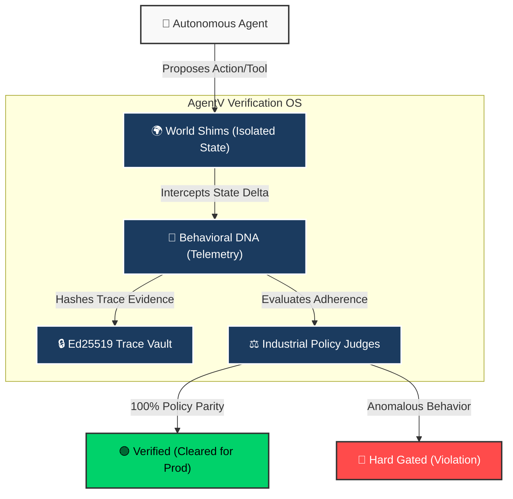

<!-- README.md (root of the project) -->

# 🛡️ AgentV, The Verification OS for Enterprise AI Agents

[](https://github.com/najeed/ai-agent-eval-harness/actions)
[](https://opensource.org/licenses/Apache-2.0)
[](https://github.com/najeed/ai-agent-eval-harness)


## The Reliability Gap: Why AgentV Exists

**88% of enterprise AI agents fail to reach production.** Not because the model is wrong. Because no one verified that the agent actually did the right thing.

AgentV sits inside the execution loop and verifies state parity, policy adherence, and business outcomes before your agent earns the right to act. Cryptographically signed traces (Ed25519), deterministic policy verification, CI/CD hard gating, NIST AI-100-1 aligned, and built for regulated industries.

*[5,000+ OOTB scenarios] • [50+ verticals] • [Apache 2.0] • [AgentV Control Plane (Enterprise Edition) available]*

## Architecture Overview




| Attribute | Specification |
| :--- | :--- |
| **License** | Apache License 2.0 |
| **Status** | 🟢 RC1 (NIST AI-100-1 Alignment) |
| **Version** | v2.0.0 RC1 (October 2026 Release) |
| **Trust Model** | [Behavioral DNA & VC v3.0.0](docs/src/content/docs/spec/trust_v3.md) |
| **Architecture** | [3-Pillar Enterprise Verification OS](docs/src/content/docs/builder/architecture.md) |
| **Quick Links** | [Quickstart](#zero-key-quickstart-get-running-now) • [AES v1.4 Spec](docs/src/content/docs/spec/aes_schema.md) • [Security](#security-and-governance-audit-ready) • [Editions](#licensing-and-editions) |


### The DNA of Agentic Reliability
- 🌍 **Environmental DNA**: Immutable snapshots of the execution environment—registry state, tool versions, and resource availability to ensure deterministic state parity.
- 🧬 **Behavioral DNA**: High-granularity telemetry (Phase → Action → Step) mapping the agent's decision-making process for precise policy adjudication and drift analysis.
- 🛡️ **Forensic DNA**: Cryptographic anchoring of the entire execution trace using Ed25519 signatures, SHA3-256 digests, and single-file `.agentv-package.json` Verification Packages.

## Table of Contents
- [What's New in the v2.0.0 RC1 Release](#whats-new-in-the-v200-rc1-release)
- [Mission](#mission)
- [Getting Started](#getting-started)
    - [Prerequisites](#prerequisites)
    - [Zero-Key Quickstart](#zero-key-quickstart-get-running-now)
    - [Manual Evaluation](#manual-evaluation-running-the-sample-agent)
- [At a Glance](#at-a-glance)
- [Integrated Visual Suite (Native GUI)](#integrated-visual-suite-native-gui)
- [Security and Governance](#security-and-governance-audit-ready)
- [Troubleshooting](#troubleshooting)
- [How to Contribute](#how-to-contribute)
- [Licensing and Editions](#licensing-and-editions)

## TL;DR: Impact in 60s
Get from zero to evaluated in seconds:
```bash
pip install agentv-runtime
agentv quickstart
```
*   **Result**: Launches mock agent, executes a telecom scenario, and builds a report.
*   **Next Step**: `agentv console` for the visual dashboard.


## Mission

Autonomous software must be provably trustworthy before it earns the right to act. AgentV is the open infrastructure that provides the evidence, not just whether your agent said the right thing, but whether it did the right thing, changed the right state, and followed the right policy.

## 🎓 Master the Art of Industrial Verification

Embark on a **4-Phase, 18-Milestone Hands-on Curriculum** designed to take you from foundational agent discovery through zero-trust production governance concepts. This is a learn-by-doing short-story based roadmap for anyone building reliable agentic systems.

| Phase | Path to Mastery | Milestones |
| :--- | :--- | :--- |
| 🟢 **Foundations** | Discovery, Native Adapters, and Sandboxing. | [Start Here](./walkthroughs/Phase%201%20-%20Foundations%20-%20Beginner) |
| 🟡 **Scale** | Batch Evaluation, Pack Management, and Mutation. | [Go Intermediate](./walkthroughs/Phase%202%20-%20Scale%20%26%20Robustness%20-%20Intermediate) |
| 🔴 **Intelligence** | Auto-Translation, Multi-Agent, and DAG Loops. | [Go Advanced](./walkthroughs/Phase%203%20-%20Intelligence%20%26%20Complexity%20-%20Advanced) |
| 🟣 **Governance** | Trace Replay, IJA Consensus, and HITL Overrides. | [Become Expert](./walkthroughs/Phase%204%20-%20Production%20%26%20Governance%20-%20Expert) |

👉 **[Launch the Master Syllabus](./walkthroughs/README.md)** to begin your journey.

## Getting Started

### Prerequisites

-   **Python 3.12+**
-   **pip**

> [!IMPORTANT]
> ### Zero-Key Quickstart (Get Running Now)
> The fastest way to see the harness in action - **no API keys or LLM setup required**:
>
> ```bash
> # 1. Clone the repository
> git clone https://github.com/najeed/ai-agent-eval-harness.git
> cd ai-agent-eval-harness
>
> # 2. Set up a virtual environment (Recommended)
> python -m venv venv
> venv\Scripts\activate  # On Windows
> source venv/bin/activate  # On macOS/Linux
>
> # 3. Install the package in editable mode
> pip install -e .
>
> # 4. Run the Deterministic Quickstart (CLI)
> agentv quickstart
> ```
>
> **What it does:** Spawns a deterministic in-process mock agent, executes a telecom troubleshooting evaluation, and generates a rich HTML report in `reports/`. 100% offline-ready.

> [!TIP]
> **Prefer a visual experience?** After running the quickstart, launch the **Integrated Visual Suite** to replay the trace interactively: `agentv console`. This includes the **Visual AES Builder** for zero-code scenario design. See the [Developer Guide](docs/src/content/docs/builder/developer-guide.md) for details.


## Harness Structure
The harness is organized into the following key components:

-   `/agentv_runtime`: Public Runtime Contracts & Neutral Architecture Seam (`interfaces`, `reference`, `session_components`, `canonical`).
-   `/dataproc_engine`: High-fidelity industrial data extraction engine (7 Sectors, Gold Standards).
-   `/industries`: Evaluation assets (5,000+ starter scenarios) categorized by 50+ industries.
-   `/eval_runner`: Modular Core Engine (Multi-turn loop, Sandbox, Metrics, Simulators, Mutator).
-   `/eval_runner/console`: Flask-based REST API for the Integrated Visual Suite.
-   `/ui/visual-console`: React + Vite Visual Suite (Live Debugger, Trust Center, Scenario Composer). Build with `npm ci && npm run build` inside the directory — `ui/visual-console/dist` is what the console serves.
-   `/examples`: Sample drift traces and triage scenarios for rapid onboarding.
-   `/reports`: Generated artifacts (JSONL, trajectories, HTML heatmaps).
-   `/runs`: Local execution history (Flight Recorder logs).
-   `/spec/aes`: **Agent Eval Specification (Foundational)** - Benchmark standard v1.4.
-   `/docs`: Astro Starlight Documentation Platform v2 (guides, architecture, and API specifications).
-   `/tests`: Comprehensive test suite (Unit, Integration, Golden, Acceptance, Red-Teaming).
-   `/sample_agent`: Reference implementation for benchmark testing.

- **NIST AI-100-1 Alignment**: Core verification logic developed following **NIST AI RMF principles**, featuring the **Weighted Severity Model (WSM)** for multi-dimensional scoring and forensic **Environmental DNA** snapshots.
- **State Parity Verification**: NIST-aligned mechanism ensuring cryptographic alignment between the agent's internal state and the physical environment (via `initial_state`).
- **Regulatory Safety Floor**: Prevents "safety-washing" by capping aggregate scores at **0.49 (Fail)** if foundational Safety or Security dimensions are compromised.
- **Behavioral DNA Telemetry**: High-granularity event bus (4-level: PHASE, SUBTASK, ACTION, STEP) providing a precise "genetic" map of agent decision-making.
- **Verification Certificate (VC) v3.0.0**: Traces are signed via the **Identity Registry** (Ed25519) and backed by a **Forensic Evidence Ledger** that hashes sidecar artifacts to ensure end-to-end provenance.

### What's New in the v2.0.0 RC1 Release

The **v2.0.0 RC1 Release** establishes AgentV as the open verification operating system for autonomous agents, delivering enterprise-grade verification guarantees, audit defensibility, resilient execution, and zero-trust extensibility since the v1.9.0 release:

- 🖥️ **Interactive Visual Console & 3-Pillar Information Architecture**: Canonical React 18 SPA mounted at `/` featuring a 3-Pillar hierarchy (**Scenarios**, **Runs**, **Evidence**), a guided 6-stage verification wizard, Dagre LR execution DAG topology rendering, Monaco editor source-of-truth document sync with typed assertions (`exact`, `regex`, `numerical_tolerance`, `json_schema`), resilient SSE streaming with `Last-Event-ID` trace replay, persistent zero-config bootstrap authentication (`.aes/keys/bootstrap.key`), non-blocking `Viewer` role, and sliding-window IP rate limiting.
- 🛡️ **Fail-Closed Airgap Boundary & Anti-DNS Rebinding**: Strict offline airgapped operation via `AIRGAPPED_MODE=true` and `AirgappedConfigurationError`. Enforces destination-IP resolution and private subnet validation (RFC 1918, loopback, link-local, private IPv6) across all HTTP adapters and LLM providers. Hardens against DNS rebinding via destination-IP pinning, redirect hop inspection, dynamic Visual Console CSP (`CONSOLE_CSP`) stripping external CDNs (`https://cdn.jsdelivr.net`), and offline bundling of local Mermaid diagram assets.
- 🔒 **WORM Storage Tier Governance & Fail-Closed Certification Gate**: Formal classification of `LocalFileArtifactStore` as `TAMPER_EVIDENT_LOGICAL_SEAL`. Enforces `REQUIRE_IMMUTABLE_WORM=true` certification gate for fail-closed rejection of logical seals when physical hardware WORM storage is required by compliance policy. Propagates zero-touch WORM retention metadata (`retention_days`, `retention_until`, `legal_hold`) in `.meta.json` sidecars, sealed manifests, and plugin hook dispatches.
- ⏸️ **Durable Human-in-the-Loop (HITL) Lifecycle & Monotonic Resumption**: Dedicated `RunSuspendedForApproval` exception and `PAUSED_FOR_APPROVAL` lifecycle state. File- and SQLite-backed `ApprovalStore` with cryptographic approval tokens. Monotonic trace sequence continuation (`is_resume=True`, `_seq = max(_seq) + 1`) in `FlightRecorder` preserving execution vaults without run ID collisions, and CLI resumption via `agentv hitl-resume`.
- 🧬 **Unified 9-Vector Adversarial Mutation Matrix & Static Linter Chaining**: Formal 3D taxonomy coordinates ($V \times O \times T$) across 9 mutation vectors (Input, Context, Memory, Retrieval, Tool, State, Authorization, Temporal, Objective), 13 operations, and 6 risk tiers (35+ registered mutators). Direct integration of `ScenarioLinter` in-memory static analysis (`lint_dict()`) into `ScenarioMutator`, `agentv mutate`, and Visual Console `POST /v1/mutate` with tiered compliance scoring (`GOLD` 100/100, `SILVER` 80-99, `BRONZE`, `REJECTED`).
- 📦 **Single-File Immutable Verification Packages (`.agentv-package.json`)**: Self-contained audit packages (`/api/v1/evidence/packages/<run_id>`) bundling full scenario definitions, resolved execution manifests, trace SHA3-256 digests, assertion proofs, and Ed25519 cryptographic provenance signatures conforming to NIST AI 100-1 and EU AI Act auditability guidelines. Split Package Verification API (`verify_package_signature_only`, `verify_package_artifacts`) and independent CLI `agentv verify-package`.
- 📜 **RFC 8785 JSON Canonicalization (JCS) & SHA3-256 Standardization**: Pure RFC 8785 canonical encoding (`agentv_runtime.canonical`), whole-envelope detached trace sealing, external trust root anchoring, and standardization on SHA3-256 (FIPS 202) across all forensic hashes, session keys, and evidence ledgers. Public-key-only trace verification eliminating private key exposure.
- ⚖️ **Server-Authoritative Outcome Derivation & Atomic Certification**: Certification Authority deriving verdicts and scores authoritatively from terminal execution events (`run_end`, `session_decision`, `evaluation_result`), strict prohibition of caller status/score overrides, 4-state fail-closed readiness (`BLOCKED`, `READY_TO_EXECUTE`, `READY_TO_CERTIFY`, `CERTIFIABLE`), and atomic two-phase certification transactions with rollback.
- 🔌 **Complete 12-Interface Extension Family Ecosystem (`agentv_runtime.interfaces`)**: Root authoritative contract package actively wiring all 12 public extension and storage interfaces (`ExecutionBackend`, `CheckpointStore`, `SigningBackend`, `ArtifactStore`, `PolicyEvaluator`, `AuthorizationBackend`, `CatalogStore`, `RunStore`, `LeaderboardStore`, `MutationEngine`, `BoundedStateProvider`, `ApprovalStore`). Decomposition of monolithic session management into 6 specialized subsystem managers (`TurnStateManager`, `ToolExecutionCoordinator`, `SessionCheckpointManager`, `SessionApprovalManager`, `SessionStateParityManager`, `SessionMetricsCalculator`).
- ⚡ **High-Performance Zero-Touch CLI Dispatch Architecture**: Lazy subparser compilation and isolated dynamic entry-point discovery achieving sub-100ms startup times for lightweight commands (`--help`, `--version`, `aes validate`, `lint`, `inspect`). Added `agentv hitl-resume`, `agentv verify-package`, `agentv lint`, and authoritative `--execution-mode [live|hybrid|simulated]` on `agentv run`.
- 🔍 **External Tool Receipts Ingestion & Provenance Boundaries**: Ingests agent self-reported external tool execution trajectories via typed `EXTERNAL_TOOL_CALL` and `EXTERNAL_TOOL_RESULT` events (`source="external_agent_telemetry"`, `provenance="reported"`) with strict provenance boundary isolation prohibiting masquerading as sandbox-authoritative. External State Authorities (`ExternalStateAuthority`) and Bounded State Contract (`BoundedStateProvider`) preventing memory exhaustion dumps.
- 🌐 **Centralized LLM Resilience & Zero-SDK Direct Transports**: Centralized error classifier (`eval_runner.llm_resilience`) mapping typed domain errors (`LLMQuotaExceededError`, `LLMRateLimitError`, etc.) with full-jitter exponential backoff retries, direct `aiohttp` REST transports (Anthropic, OpenAI, Grok, Ollama), and official `google-genai` SDK support.
- 🧪 **Dedicated Acceptance Testing Layer & CI Release Gate**: Schema-validated acceptance testing corpus (`tests/acceptance/`), decoupled contracts (`result.py`), golden matrix (`manifests/acceptance_matrix.yaml`), and zero-tolerance release gate (`tools/ci/acceptance_gate.py`).
- 📜 **Multi-Tenant ExecutionManifest & Dual-Tier Readiness**: Immutable frozen [`ExecutionManifest`](agentv_runtime/manifest.py) binding tenant and workspace context, deterministic SHA3-256 `preflight_fingerprint` cache invalidation, and strict readiness gating (**Executable** vs **Verifiable**).

## 📂 The Global Scenario Corpus

The harness now ships with a validated corpus of **5,000+ scenarios** designed to test agents across various industry workflows and edge cases:

### 🏛️ Industry-Specific (4,000+ Scenarios)
Comprehensive coverage for **50+ verticals** including:
- **Finance & Banking**: Loan processing, fraud detection, and regulatory audits.
- **Healthcare**: PII handling, insurance reconciliation, and diagnostic workflows.
- **Telecom & Energy**: Network troubleshooting, grid optimization, and billing.

### 🧠 Advanced Categories (1,000+ Scenarios)
- **Cross-Industry Negotiation**: Scenarios where agents must bridge data and policy gaps between two distinct verticals (e.g., Legal & Healthcare).
- **Ethical & Safety Guardrails**: Hardened tests for PII leakage, prompt injection, and bias.
- **Interactive Complexity**: Multi-turn flows involving conflicting human-in-the-loop (HITL) requirements.
- **Simulations**: High-fidelity sector labs (e.g., Bank, EHR/HL7, CRM) for testing agents in realistic, isolated environments.

*All scenarios are 100% compliant with the [AES v1.4 Specification](docs/src/content/docs/spec/aes_schema.md).*


### Manual Evaluation (Running the Sample Agent)

1.  **Start your Agent**: The framework includes a reference agent for testing.
    ```bash
    python sample_agent/agent_app.py
    ```
2.  **Set Endpoint**: Point the harness to your agent's webhook.
    ```bash
    set AGENT_API_URL=http://localhost:5001/execute_task   # Windows
    export AGENT_API_URL=http://localhost:5001/execute_task # Mac/Linux
    ```
3.  **Run Evaluation**: 
    ```bash
    # Standard HTTP (default)
    # Single Scenario Execution (with authoritative execution mode recorded)
    agentv run --path loan_risk --execution-mode live

    # Using project-relative path (Ad-hoc single scenario)
    agentv run --path industries/telecom/scenario.json --execution-mode live

    # Batch evaluation across an entire directory or pack
    agentv evaluate --path industries/telecom

    # Local Subprocess (stdin/stdout)
    agentv run --path my_scenarios/test.json --protocol local --agent-cmd "python my_agent.py"

    # Socket (TCP/Unix)
    agentv run --path tests/scenarios/test.json --protocol socket --agent-socket "localhost:9000"
    ```

> [!NOTE]
> **Path Decoupling**: The harness now supports ad-hoc evaluations anywhere on your filesystem. Metadata like `industry` is inferred from the file content or folder structure, defaulting to `local` and `unclassified` for external files.

---

## Agent Communication Protocols

The harness supports multiple ways to talk to your agent. Use the `--protocol` flag to select the adapter and `--agent` (or specialized flags) to specify the endpoint.

| Protocol | Description | Configuration Flag | Env Variable |
| :--- | :--- | :--- | :--- |
| **HTTP** | Standard REST API (POST) | `--protocol http` (default) | `AGENT_API_URL` |
| **SSE** | Server-Sent Events | `--protocol sse` | *(None)* |
| **Local** | Local process via stdin/stdout | `--protocol local` or `--agent-cmd` | `AGENT_LOCAL_CMD` |
| **Socket** | TCP or Unix Domain Socket | `--protocol socket` or `--agent-socket` | `AGENT_SOCKET_ADDR` |
| **OpenAPI** | OpenAPI spec (REST) | `--protocol openapi` | *(None)* |

---

## At a Glance

- **Evaluation Specification (AES)**: Standardized YAML/Markdown benchmarks for agents.
- **20-Shim Enterprise Suite**: Environment simulators for **Git, API, Database, Knowledge Base, Support Desk, Social Media, Vector DB, CI/CD, IoT, Security**, and more (AgentV Control Plane supports high-fidelity versions).
- **Schema-Driven Core Registry**: Decoupled environmental state management using declarative manifests (`shim_resources.json`) with **Async Simulation Hardening** for non-blocking non-linear evaluations.
- **PBAC & Operational Governance**: Granular **Permission-Based Access Control** (v1.2.3) and **Operational Throttling** (`EVAL_TURN_THROTTLE`) for regulated enterprise environments.
- **Zero-Touch Hot-Swap Architecture**: Dynamically register and swap simulators via plugins without core code modifications.
- **Benchmark Ecosystem**: Native loaders for GAIA (HuggingFace Integration) and AssistantBench. Supports benchmark URI schemes (e.g., `gaia://2023`, `assistantbench://v1`) for zero-config execution.
- **Native Framework Adapters**: Full industrial-grade support for **LangChain**, **LangGraph**, **Microsoft AutoGen** (via `ag2://`), and **CrewAI** via a dynamic plugin-discovery system.
- **High-Fidelity Industry Metrics**: Modular, pluggable evaluators for Defense (ROE, C2, Intelligence Fusion), Healthcare, and Finance. Features high-precision numerical extraction and domain-specific LLM rubrics.
- **Tool Sandbox**: Governance-controlled execution with full VFS-aware state parity verification and TOCTOU barrier race protection.
- **AST Mutation Testing Sentinel**: Surgical AST mutation testing pipeline enforcing >=90% kill rate (100% achieved, 0 surviving mutants) across critical verification modules.
- **Integrated Visual Suite**: Canonical React SPA featuring dynamic navigation manifest ingestion (`GET /api/nav`), runtime micro-frontend module federation, live trace replay, and visual debugging.
- **Stratified Failure Taxonomy**: Formal, Enum-based failure registry (NIST-aligned) for precise, audit-grade root-cause diagnostics.
- **Semantic Bridge**: Ingest production traces (`import-drift`) and analyze failures (`triage`).
- **Judge Guarding**: Model-based scoring with support for OpenAI, Gemini, Claude, and Ollama.

#### Advanced CLI Suite
- **`run`**: Single-scenario execution with authoritative `--execution-mode [live|hybrid|simulated]` via `--path`.
- **`evaluate`**: Batch evaluation across scenario directories or benchmark suites via `--path`.
- **`hitl-resume`**: Resume an evaluation run paused during human review via `--run-id`, `--approval-token`, and `--decision APPROVED|REJECTED`.
- **`verify-package`**: Independently verify an `.agentv-package.json` audit package with deep cryptographic and scenario binding checks.
- **`list`**: Faceted search filtering across 5,000+ industry scenarios via `--search`.
- **`lint`**: Automated quality scoring and AES compliance verification via `--path`.
- **`install <pack>`**: Rapid deployment of curated, industry-specific scenario bundles (e.g., `telecom-pack`, `rag-agent-pack`).
- **`analyze <url>`**: Proactive agent repo scanning; auto-generates AES stubs by identifying tools and endpoints.
- **`ci generate`**: One-click scaffolding of GitHub Actions workflows for evaluation-on-PR.
- **`failures search`**: Intelligence-driven retrieval of edge cases from the global failure corpus.
- **`explain`**: AI-powered trace diagnostics (loops, timeouts, PII leaks) via `--run-id <id>`.
- **`certify`**: Generate a non-repudiable Verification Certificate (VC) for a specific run trace using `--run-id`.
- **`verify`**: Verify the cryptographic integrity of a run trace using autonomous artifact resolution via `--run-id`.
- **`gate`**: "Hard Gating" tool for CI/CD pipelines to enforce signature and hash matches via `--run-id`.
- **`auto-translate`**: Leverage local LLMs (via Ollama) to convert raw documents into executable AES scenarios.
- **`aes add-standard`**: Expand the global industrial registry with new standard definitions (ID, Name, Industry, Description).
- **`init --standard <id>`**: Rapidly scaffold a dedicated, industry-compliant evaluation environment for a specific standard (e.g., `init --standard ISO_20022`).

and more (check [CLI Reference](docs/src/content/docs/evaluator/cli.md) for complete list) ...


#### Premium UX Tools
- **Scenario Editor**: A visual interface for constructing real-world AES logic; saves production-ready JSON directly to the catalog.
- **VS Code Extension**: Run evaluations and visualize timelines directly within your IDE.
- **Visual Debugger**: Real-time trajectory playback with interactive state inspection (Live Engine Hook).

---

The harness is built on a decoupled, event-driven architecture that allows custom integrations to be hot-swapped without core modifications.

- **EventEmitter Bus**: Passive observation of every turn, tool call, and state change.
- **🧩 Pluggable Judge Layer**: Configurable model-based scoring with support for OpenAI, Gemini, Claude, and Ollama.
- **🏥 High-Fidelity Metrics Framework**: Decoupled, category-based evaluators (Accuracy, Planning, Defense, Technical) with extensible registration.
- **Industry-Standard Rubrics**: Specialized evaluators for Clinical Safety, Fiduciary Accuracy, Strategic Planning, and Causal Inference.
- **Native HITL Support**: built-in pausing for human intervention via the `human` adapter.
- **Advanced Discovery**: Plugin-driven registry for third-party agent adapters (LangGraph, CrewAI, AutoGen, Grok).
- **Pluggable World Shims**: Register custom environment simulators through the `on_register_simulators` hook.
- **Pluggable Console & GUI Extensions**: Inject custom React views, dynamic navigation manifests, and REST endpoints via the `on_register_console_routes` hook.

### 🛠️ dataproc-engine: Industrial Extraction Core
The repository also features a standalone extraction engine designed for high-fidelity data acquisition:
- **Sector Coverage**: Finance, Healthcare, Energy, Telecom, Ecommerce, Agriculture, and Transportation.
- **Zero-Mock Integrity**: Automated fallback to high-fidelity simulations when live APIs are unavailable, maintaining 100% data availability.

Beyond the advanced suite, the harness provides a robust toolkit for professional evaluation:
- **`doctor`**: Environment health checker.
- **`report`**: Rich HTML reporting with interactive Mermaid trajectories via `--path`.
- **`record` & `playground`**: Interaction capture and REPL experimentation for rapid prototyping.
- **`spec-to-eval`**: Convert Markdown PRDs/Specs into executable JSON scenarios. Supports `--fill-defaults` to rapidly generate lint-compliant stubs.
- **`scenario generate`**: Interactive scaffolding for manual test authoring.
- **`mutate`**: Adversarial scenario generator (typos, injections, ambiguity).
- **`import-drift`**: Convert production logs into regression test cases.

## Integrated Visual Suite (Native GUI)

The harness includes a canonical **React 18 + Vite SPA** that unifies scenario management, deterministic execution, and audit-grade verification across all industries.

**Key Feature Hubs:**
- **3-Pillar Information Architecture**: Structured around three first-class verification primitives: **Scenarios** (`/scenarios`, `/scenarios/compose`, `/suites`), **Runs** (`/runs`, `/reports`, `/debugger`, `/triage`), and **Evidence** (`/evidence/packages`, `/trust`, `/compliance`, `/publish`).
- **Guided 6-Stage Verification Wizard**: Step-by-step workflow: *Connect Target Profile → Select Scenario/Suite → Review Resolved Config → Execute & Stream → Evidence-Linked Verification → Export Verification Package*.
- **Interactive Visual Debugger**: Real-time Dagre LR execution DAG topology playback with Monaco editor document sync, typed assertions (`exact`, `regex`, `numerical_tolerance`, `json_schema`), resilient SSE streaming with `Last-Event-ID` trace replay, and scrollable State Parity inspection.
- **Scenario Explorer & Composer**: Browse the global catalog with faceted filters, search, and real-time **Quality Badges** (Lint scores); edit scenarios non-destructively with node-level visual drag-and-drop.
- **Trust Center & Cryptographic Sealing**: Verify trace evidence graphs, issue non-repudiable Verification Certificates (VC v3.0.0), and export single-file `.agentv-package.json` packages.
- **Zero-Config Bootstrap Authentication**: Persistent 64-character SHA3-256 session key (`.aes/keys/bootstrap.key`, `0600` permissions) in development, non-blocking `Viewer` role, and sliding-window IP rate limiting.

**Quick Launch:**
```bash
agentv console
```
*Access via browser at `http://localhost:5000`. The console features an adaptive, premium dark-mode UI with high-density data visualizations.*

### Running Tests

```bash
python -m pytest
```

### Centralized Configuration

All configurable parameters are centralized in `eval_runner/config.py`. You can override any setting via environment variables.

| Variable | Default | Description |
|---|---|---|
| `AGENT_API_URL` | `http://localhost:5001/execute_task` | Agent entry point URL (HTTP) |
| `EVAL_MAX_TURNS` | `10` | Max conversation turns per task |
| `MAX_ENGINE_ATTEMPTS` | `50` | Security cap on evaluation attempts |
| `AIRGAPPED_MODE` | `false` | Strict zero-egress fail-closed protection and destination-IP validation |
| `REQUIRE_IMMUTABLE_WORM`| `false` | Fail-closed certification requirement for physical hardware WORM storage |
| `EVAL_REQUIRE_SIGNING` | `false` | Require cryptographic Ed25519 signing for all execution traces |
| `JUDGE_PROVIDER` | `ollama` | LLM Judge provider (`openai`, `anthropic`, `gemini`, `ollama`, `grok`) |
| `JUDGE_MODEL` | *(None)* | Specific model for the judge |
| `LUNA_JUDGE_TEMPERATURE`| `0.0` | Temperature for judge generation |
| `OLLAMA_HOST` | `http://localhost:11434` | Local Ollama host URL |
| `OLLAMA_MODEL` | `llama4` | Default Ollama model |
| `OPENAI_API_KEY` | *(None)* | API key for OpenAI provider |
| `ANTHROPIC_API_KEY`| *(None)* | API key for Anthropic/Claude provider |
| `GOOGLE_API_KEY` | *(None)* | API key for Google/Gemini provider |
| `XAI_API_KEY` | *(None)* | API key for xAI/Grok provider |
| `DASHBOARD_API_KEY`| *(None)* | Mandatory key for Visual Debugger & REST API security |
| `CONSOLE_CSP_SCRIPT_SRC`| *(None)* | Optional operator CSP script-src directive override |
| `EVAL_TURN_THROTTLE`| `0.0` | Artificial delay (seconds) between agent turns |
| `DEFAULT_ADAPTER_TIMEOUT`| `30` | Network timeout for agent adapters |
| `PLUGIN_TIMEOUT` | `5.0` | Execution timeout for plugin hooks |
| `REPORTS_DIR` | `reports` | Base directory for generated reports |

... and more.

### Security and Governance (Audit-Ready)
The platform is built with a **Secure-by-Design** philosophy, complying with enterprise-grade audit standards.

- **Fail-Closed Airgap Hardening**: Strict offline operation via `AIRGAPPED_MODE=true` with private subnet destination-IP validation (RFC 1918, loopback, link-local, private IPv6), anti-DNS rebinding defenses via destination-IP pinning, and dynamic CSP CDN stripping.
- **PII/Secret Redaction**: Automatic, recursive scanning and redaction of JWTs, AWS keys, and PII from all event logs.
- **Zero-Config Bootstrap Authentication**: Persistent 64-character SHA3-256 session key generated in `.aes/keys/bootstrap.key` (POSIX `0600` permissions) with strict fail-fast production key enforcement.
- **Secure Handoff Architecture**: JWT-based authentication between the core console and enterprise plugins.
- **Tool Sandboxing**: Path traversal protection and shell-character neutralization for all tool executions.
- **WORM Tier Governance**: Open Core storage is classified as `TAMPER_EVIDENT_LOGICAL_SEAL`; compliance mandates for physical hardware WORM storage fail closed unless backed by an external WORM ArtifactStore (`REQUIRE_IMMUTABLE_WORM=true`).
- **In-Archive ZIP Safety**: Direct in-memory verification of `.agentv-package.json` bundles with pre-extraction path traversal defense (anti-Zip Slip).
- **Audit Controls**: Defense-in-depth security controls (DoS caps, Fork Bomb prevention, RCE guards, and jail isolation). See the [Security Guide](docs/src/content/docs/auditor/security.md) for generation and configuration instructions.
- **Mandatory Authentication**: Protection of all console and bridge routes via session authentication or `DASHBOARD_API_KEY`.

### 🗄️ Forensic Storage & Vaulting
AgentV employs a **Strict Industrial Vault** methodology to protect run integrity:
- **Individual Vaults**: By default, each execution is isolated in its own directory (`runs/<run_id>/run.jsonl`).
- **Master Log**: A consolidated flight recorder at `runs/run.jsonl` tracks all system turns for aggregate analysis.
- **Rotation**: The built-in rotation mechanism manages entire Vault Directories, purging historical subdirectories to maintain storage efficiency while preserving the most recent forensic artifacts. It is recommended to periodically clean up this directory via `agentv cleanup-runs`.

### Troubleshooting

- **`ConnectionRefusedError`**: The harness cannot reach the agent. Ensure `AGENT_API_URL` is set correctly and the agent API is running.
- **`PluginTimeoutError`**: A registered plugin took too long to execute a hook. Check your plugin logic or increase the timeout.
- **`Invalid JSON Error (LLM)`**: The `auto-translate` command expects strict JSON. Ensure your local Ollama model (e.g., `llama4`) is running and capable of JSON mode.
- **`docker: command not found`**: You need to install Docker if you intend to use Lab Mode.

---

## 🚀 Advanced Setup (Docker & Lab Mode)

For researchers needing full isolation or enterprise-grade local dashboards, we provide a containerized stack.

### Prerequisites
- **Docker & Docker Compose**:
    - **Windows/Mac**: Install [Docker Desktop](https://www.docker.com/products/docker-desktop/).
    - **Linux**: Install [Docker Engine](https://docs.docker.com/engine/install/) and [Docker Compose](https://docs.docker.com/compose/install/).

### Launching the Stack
```bash
docker compose up --build
```
This orchestrates the Flask backend, the React frontend, and the execution engine in a secure, isolated network.

### Running Lab Mode without Docker
If you cannot install Docker, run these 2 commands in separate terminals:
1. `python sample_agent/agent_app.py`
2. `agentv console`

## How to Contribute

This is a community-driven project, and we welcome contributions! Please see our [CONTRIBUTING.md](CONTRIBUTING.md) file for detailed guidelines on how to add new industries, scenarios, or improve the engine.

Here are ways to get involved:

### 🌟 Quick Contributions
- ⭐ Star this repository
- 🐛 [Report bugs](https://github.com/najeed/ai-agent-eval-harness/issues/new?template=bug_report.md)
- 💡 [Suggest features](https://github.com/najeed/ai-agent-eval-harness/issues/new?template=feature_request.md)
- 📖 [Improve documentation](https://github.com/najeed/ai-agent-eval-harness/issues/new?template=documentation.md)

### 🔨 Code Contributions
- 🆕 [Good first issues](https://github.com/najeed/ai-agent-eval-harness/labels/good%20first%20issue)
- 🧪 Add test scenarios
- ⚖️ **Zero-CLA**: We use the DCO (Developer Certificate of Origin). Just `git commit -s`.
- 🏭 [Contribute new industries](https://github.com/najeed/ai-agent-eval-harness/issues/new?template=industry_request.md)
### Contributors
Thanks to all our contributors! 🙌

<a href="https://github.com/najeed/ai-agent-eval-harness/graphs/contributors">
  
</a>

## Licensing and Editions

This project follows an **Open Core** model. The open-source AgentV OS Runtime capabilities provide a robust verification foundation, while the AgentV Control Plane delivers the necessary security, governance, and audit-grade intelligence required for regulated deployments.

| Feature Module | AgentV OS Runtime (OSS) | AgentV Control Plane |
| :--- | :--- | :--- |
| **Core Architecture** | ✅ Eval Engine, Hooks, JSON Schemas | ✅ Enterprise Service Bus Integration |
| **Industry Benchmark Set** | ✅ 5,000+ Starter Scenarios | ✅ Prioritized Scenario Updates |
| **Reliability Metrics** | ✅ `pass@k` multi-attempt scoring | ✅ Persistent Leaderboards & Consensus |
| **Scenario Mutations** | ✅ 9-Vector Matrix ($V \times O \times T$, 35+ mutators, Linter) | ✅ Distributed Adversarial Fuzzing & Enterprise Seed Pools |
| **Execution Security** | 🔶 VFS Sandboxing & Tool Gating | ✅ Context Payload Caps & Overflow Guards |
| **Privacy Protections** | ❌ No | ✅ Automatic PII Scanning & Redaction |
| **Simulation** | 🔶 Real API & 20 World Shims | ✅ High-Fidelity Labs (Bank, EHR/HL7, CRM) |
| **Compliance Suites** | ❌ No | ✅ Production-Ready (HIPAA, FINRA, GDPR, PCI) |
| **Observability** | 🔶 Live SSE Streaming & Flight Recorder | ✅ OTEL Drift Gauges & Enterprise APM Feed |
| **Defensibility Governance**| ✅ Ed25519 Sealing, JCS, Logical WORM Packages | ✅ Physical Hardware WORM Retention & Legal Holds |
| **Integrity Checks** | ✅ Ed25519 Trace Validation & RFC 8785 JCS | ✅ AES Scenario Merkle Sync (Root Verify) |
| **Visual Debugger & GUI** | ✅ Canonical React 18 + Vite SPA | ✅ Enterprise Dashboard & Secure Handoff |
| **Reproduction Workflow** | 🔶 Flight Recorder JSONL & HTML Reports | ✅ Interactive Cloud Replay & Jupyter Repro |
| **Parallel Engine** | 🔶 Sequential & Local Worker Concurrency | ✅ Ray/Local JobQueue Distributed Runs |
| **Interactive Triage** | 🔶 Heuristic Trace Diagnostics (`explain`) | ✅ Multi-user Sync & Human Annotation |
| **Advanced Sandbox** | 🔶 VFS Path & Shell Gating | ✅ Hardened Docker Isolation & Red-Team Probes |
| **Auth & Governance** | ✅ Zero-Config Bootstrap Key (`0600`), PBAC, RBAC | ✅ OIDC SSO, SCIM Provisioning, Managed Directories |

**Legend:** ✅ Full Capability • 🔶 Basic/OSS Only • ❌ Enterprise Only

### 🛡️ Add the Badge to Your Agent

Showcase your agent's rigorous reliability by adding the official **Works with AgentV** badge to your repository to show that it has been evaluated by the AgentV framework.

#### Option 1: Using img.shields.io
You can use the Shields.io service to generate a consistent badge for your project:

```markdown
[](https://github.com/najeed/ai-agent-eval-harness)
```

#### Option 2: Using GitHub Asset
Alternatively, link directly to our high-fidelity SVG asset:

```markdown
[](https://github.com/najeed/ai-agent-eval-harness)
```

---

Ready for production-grade verification? The AgentV Control Plane can supply externally retained WORM audit storage, OIDC SSO, PBAC, HIPAA/FINRA/GDPR compliance packs, and Docker-sandboxed isolation.

👉 Book a 30-minute call: [AgentVOS.ai](https://agentvos.ai)

### License
The core of this project is licensed under the **Apache License 2.0**. 
See the [LICENSE](LICENSE) file for details.
