# AgentV Signatures — Exhaustive Specification Guide

**Profile:** `agentv.signature.digest-envelope.v1` · **Envelope version:** `1` · **Schema:** [`digest-envelope.schema.json`](digest-envelope.schema.json) · **Contract date:** 2026-10-30

Companion specs: [Verification Certificates](../vc/VC_SPEC_EXHAUSTIVE_GUIDE.md), [Verification Packages](../agentv-package/AGENTV_PACKAGE_EXHAUSTIVE_GUIDE.md), [Runs](../runs/RUNS_SPEC_EXHAUSTIVE_GUIDE.md), and [Extensions](../extensions/EXTENSION_MANIFEST_EXHAUSTIVE_GUIDE.md).

Implementation: [`agentv_runtime/signatures.py`](../../agentv_runtime/signatures.py). This guide defines the signature profile; the companion artifact and authoritative-verdict contracts still apply. A signature proves the authenticity of its signed commitments, not that an agent succeeded.

---

## 1. Purpose and Trust Model

The profile lets a bounded RAW Ed25519 signer attest a large canonical artifact without sending the entire artifact to the signer. The signer receives a small canonical envelope containing the payload digest and all algorithm, purpose, projection, and key bindings.

The signed message is exactly:

```text
Ed25519.Sign(private_key, RFC8785(envelope))
```

The payload commitment inside that message is:

```text
payload_bytes = RFC8785(unsigned_projection(artifact, purpose))
payload_digest = lowercase_hex(SHA256(payload_bytes))
```

The SHA-256 payload digest and Ed25519's internal hashing are separate operations. This profile is **not Ed25519ph**, direct RAW signing of the original payload, or an unspecified “sign digest” operation.

Trust invariants:

- The verifier reconstructs the artifact projection and digest from the actual artifact.
- Purpose, projection, canonicalization, algorithms, encodings, identity, and key fingerprint are signed and checked against expected values.
- An **external trust anchor** authorizes the key. An embedded public key or signed fingerprint cannot authorize itself.
- Unsupported or malformed envelopes fail closed. Rejected envelopes are never retried as legacy signatures.
- Remote failures propagate. They never select a local key as an outage recovery path.
- Successful certificate issuance requires independent verification before the provider's atomic certification commit and seal.

```mermaid
flowchart LR
    A[Artifact] --> P[Frozen unsigned projection]
    P --> C[Canonical payload bytes]
    C --> D[SHA-256 digest]
    D --> E[Envelope plus external key policy]
    E --> B[Canonical envelope: at most 4096 bytes]
    B --> S[Selected RAW Ed25519 signer]
    S --> R[Complete structured result]
    R --> V[Independent verification]
    V --> T[Atomic certificate commit and seal]
```



## 2. Scope and Version Boundaries

V1 supports three purposes:

| Artifact | `purpose` | `payload_projection` |
| --- | --- | --- |
| Verification certificate | `agentv.certificate` | `agentv.certificate.unsigned.v1` |
| Typed verification package | `agentv.verification-package` | `agentv.verification-package.unsigned.v1` |
| Evaluator finalization | `agentv.evaluator-finalization` | `agentv.evaluator-finalization.unsigned.v1` |

The typed verification package is [`VerificationPackage`](../../agentv_runtime/package.py), not the GUI/download wrapper surrounding certificates, traces, and graphs. Project the typed attestation itself.

Trace-event signatures, trace seals, extension manifests, and arbitrary byte streams do not acquire this profile automatically. Adding a purpose requires an explicitly defined projection and a compatible versioned contract. The artifact schema version, certificate profile, signature profile, and envelope version are different identifiers.

Unknown v1 fields are rejected where specified below. Do not add optional envelope fields, change exclusions, reinterpret a canonicalization identifier, or accept another algorithm under the existing profile. Such changes require a new contract version and reader policy.

## 3. Complete Structured Result

The result has exactly three members:

| Member | JSON type | Required interpretation |
| --- | --- | --- |
| `profile` | string | Exactly `agentv.signature.digest-envelope.v1` |
| `envelope` | object | Exactly the 18 fields in Section 4 |
| `signature` | string | Canonical padded RFC 4648 base64 encoding of exactly 64 signature bytes |

All three are mandatory. Additional result members, alternate `sig` aliases, an absent envelope, unknown profiles, or extracting a bare signature from a rejected response are invalid for v1.

The signature is outside the envelope to avoid signing itself. It covers the canonical envelope, including the envelope's signature-encoding and signature-length declarations. The result's outer `profile` must agree with the signed inner profile.

Signing backends return the complete object. Core preserves that object in certificate provenance, package publication, finalization records, and reload. It does not flatten a versioned response into its base64 signature string.

## 4. Envelope Map: Every Signed Field

| Field | JSON type | Required value or binding |
| --- | --- | --- |
| `profile` | string | `agentv.signature.digest-envelope.v1` |
| `version` | integer | `1` |
| `envelope_canonicalization` | string | `RFC8785` |
| `purpose` | string | One of the three purposes in Section 2; externally permitted |
| `payload_projection` | string | Exact projection associated with that purpose |
| `payload_canonicalization` | string | `RFC8785` |
| `payload_digest` | string | SHA-256 of the reconstructed canonical payload, 64 lowercase hexadecimal characters |
| `payload_digest_algorithm` | string | `sha256` |
| `payload_digest_encoding` | string | `hex-lowercase` |
| `signing_algorithm` | string | `Ed25519` |
| `signing_semantics` | string | `raw-ed25519-over-canonical-envelope-bytes` |
| `signer_identity` | string | Nonempty logical identity expected by the artifact and external trust policy |
| `key_id` | string | Externally authorized immutable identity in Section 8 |
| `public_key_fingerprint` | string | SHA-256 of the externally anchored public key's SPKI DER encoding, lowercase hexadecimal |
| `fingerprint_algorithm` | string | `sha256` |
| `public_key_encoding` | string | `spki-der` |
| `signature_encoding` | string | `base64-rfc4648-padded` |
| `signature_length` | integer | `64` |

Integer declarations are checked with their required types: booleans and floating-point substitutions are not accepted by the Core object contract. Neither `true` nor `1.0` substitutes for the integer version field in a structured backend response.

No field is inferred from the backend class, key size, signature length, provider name, or the presence of a digest. A genuinely signed envelope with the wrong declared purpose, key, algorithm, or projection is still rejected.

## 5. Canonicalization and JSON Transport

Projection happens **before** canonicalization. RFC 8785 does not define which artifact fields are signed.

Canonicalization uses UTF-8, UTF-16 code-unit ordering of object member names, ECMAScript-compatible finite number serialization, and no insignificant whitespace. Array order is retained except for the specific sorted arrays named in the frozen projections. Negative zero canonicalizes to `0`. Unicode strings are not case-folded, NFKC-normalized, or otherwise rewritten.

Core's [`canonical.py`](../../agentv_runtime/canonical.py) supplies the canonical serializer. `canonical_payload_from_json(raw_bytes)` supplies strict JSON transport decoding for artifact objects: it rejects duplicate members, non-finite constants/numbers, invalid Unicode, malformed JSON, non-object artifact inputs, and integer values that would require silent binary64 rounding. Exact large binary64 values may canonicalize in integer notation; they must round-trip without changing value. Unsupported Python object types are not a JSON wire format.

`unsigned_envelope()` requires the projected payload bytes to **already equal** their RFC 8785 encoding. A caller may first canonicalize a strictly decoded artifact, but may not label arbitrary raw JSON or arbitrary bytes as canonical.

Transport integrations must reject duplicate JSON keys while the original bytes are available. Once a permissive decoder has collapsed duplicates into a dictionary, a later schema or signature check cannot reconstruct the lost ambiguity. Use strict decoding before constructing the typed artifact or structured result.

Schema validation is necessary structural checking, not cryptographic verification. It cannot establish external authorization, reconstruct the payload, enforce Ed25519 validity, or replace strict base64 decoding/re-encoding and canonical-byte comparison.

The 4,096-byte limit applies to the outbound signing message, not to the original artifact. This profile does not define a streaming canonicalizer or remove application limits on artifact size, memory use, or processing time.

## 6. Frozen Unsigned Projections

The following field sets and exclusions are protocol constants. They are not backend preferences. A verifier must not try alternate field sets after a failure.

### 6.1 Certificate: `agentv.certificate.unsigned.v1`

Start with the certificate object. Exclude exactly these top-level members:

```text
provenance_chain
signing_context
certification_diagnostics
verification_package
package_hash
evaluation_hash
verification_hash
certificate_hash
```

If `certification` is an object, also exclude exactly its immediate `stages` member. Retain its remaining members.

Retain **every other certificate field**, including the complete `execution_manifest`, execution mode, provisional restrictions, evidence and trace commitments, scenario bindings, and metadata. The exclusion is not recursive: `metadata.signature`, `metadata.provenance_chain`, or an execution-manifest member named `signature` remains signed data.

The exclusions avoid circularity and omit the transient signing context/stage log. Attached package/hash fields have their own commitment and verification requirements; excluding them here does not make them optional for authoritative verification.

Producer and verifier use `certificate_payload_bytes(certificate)`. The v1 envelope path accepts this one projection only. Historical diagnostic projections are separate legacy behavior, never a retry for a failed v1 envelope.

### 6.2 Verification Package: `agentv.verification-package.unsigned.v1`

Use `VerificationPackage.canonical_payload_dict()`. The projected object contains exactly:

```text
algorithm
certificate_hash
decision
evaluation_hash
evidence_root_hash
executed_oracle_results
execution_identity
finalization_hash
key_id
manifest_hash
manifest_id
metadata
package_id
package_version
parent_artifact_refs
producer_identity
producer_version
required_oracle_ids
scenario_hash
scenario_id
scenario_version
schema_version
signer_identity
trace_hash
trace_seal
verification_hash
```

Normalization is fixed:

- Sort `required_oracle_ids` and `parent_artifact_refs`.
- Represent absent optional textual hash commitments, `key_id`, and `signer_identity` as the empty string.
- Use `finalization_hash`, otherwise `evaluation_hash`, otherwise the empty string for the projected `finalization_hash`.
- Retain all other typed values, including nested oracle evidence, restrictions, metadata, decision, execution identity, and trace seal.

Excluded transport members are `signature` and `public_key_pem`. Export-derived `package_hash`, `content_hash`, and `commitment_graph` are also excluded. Unknown top-level package members are rejected for versioned signatures, rather than silently discarded from the projection.

The embedded public key is informational. If present, it must match the external anchor; it is not an alternative trust root. The package's existing SHA3-256 content address is separate from the SHA-256 digest inside this signature envelope.

### 6.3 Finalization: `agentv.evaluator-finalization.unsigned.v1`

Use `EvaluatorFinalizationRecord.canonical_payload_bytes()` with exactly these payload fields:

```text
evaluator_config_hash
evaluator_identity
evidence_root_hash
execution_manifest_hash
finalization_id
finalized_at
metadata
outcome
required_oracle_ids
run_id
scenario_hash
scenario_id
scenario_version
schema_version
score
terminal_seq
```

Sort `required_oracle_ids`. Preserve all other typed values, including every metadata member.

Exclude `evaluator_signature`, its export/transport alias `signature`, the derived `finalization_hash`, and the export alias `manifest_hash`. The content hash is independently recomputed from the same unsigned projection.

Unknown top-level fields and conflicting signature or manifest aliases are rejected for versioned records. A caller cannot select a more permissive projection to repair a failed finalization signature.

## 7. Signature and Digest Encodings

`payload_digest` and `public_key_fingerprint` are each 32-byte SHA-256 values encoded as exactly 64 lowercase hexadecimal characters. The digest algorithms remain explicit despite their equal output lengths.

The response signature is exactly 64 Ed25519 bytes encoded as padded RFC 4648 base64. Its encoded length is 88 characters, ending in `==`. Verification must:

1. Strictly decode base64, rejecting invalid characters and whitespace.
2. Require exactly 64 decoded bytes.
3. Re-encode and require equality with the supplied string, rejecting alternate encodings and nonzero padding bits.
4. Verify those bytes against the canonical envelope and external Ed25519 key.

Hexadecimal is the legacy RAW signature encoding and the Core RAW backend interface encoding; it is not the v1 structured-result encoding. Do not interchange them by guessing from length.

## 8. Immutable Key Identity and External Trust

V1 supports these key-identity forms:

| Form | Meaning |
| --- | --- |
| `sha256:<64 lowercase hex>` | Content-addressed identity equal to SHA-256 of the external key's SPKI DER bytes |
| `arn:<partition>:kms:<region>:<12-digit-account>:key/<key-id>` | Immutable KMS key ARN pinned by external policy |

Mutable aliases such as `alias/production`, alias ARNs, or a bare human-readable key nickname are not v1 immutable key identities. Resolve an alias during trusted discovery and pin the resulting key ARN and public key together.

The external policy binds the logical signer identity to the immutable key identity, public key, permitted purposes/profiles, legacy policy, revocation state, and validity interval. The verifier recomputes the fingerprint from that external public key and compares it with the signed value. A signed fingerprint cannot bootstrap trust in an attacker-supplied key.

### 8.1 File-backed Policy

The default identity trust store uses:

```text
<TRUST_ROOT>/<logical-identity>/public_key.pem
<TRUST_ROOT>/<logical-identity>/signature_policy.json
```

Example policy, independently provisioned by the trust-store operator:

```json
{
  "version": 1,
  "key_id": "arn:aws:kms:us-east-1:123456789012:key/12345678-1234-1234-1234-123456789012",
  "permitted_profiles": ["agentv.signature.digest-envelope.v1"],
  "permitted_purposes": ["agentv.certificate", "agentv.verification-package"],
  "allow_legacy_raw": false,
  "revoked": false,
  "not_before": "2026-10-30T00:00:00+00:00"
}
```

`not_before` and `not_after` are optional, timezone-aware timestamps. Unknown policy fields, unsupported purpose/profile names, duplicate list entries, and malformed field types fail policy loading. Identity paths must remain inside the configured trust root.

When no policy file exists, the defined default policy uses the external public-key fingerprint as key identity and permits v1 plus existing `ed25519-raw` evidence for the supported purposes. This compatibility default is explicit policy behavior, not proof that a deployment has adopted a hardware-only policy. KMS ARN bindings require explicit external configuration.

### 8.2 Resolver-backed Policy

A trust resolver may implement `get_signature_policy(identity)` and return a `SignaturePolicy`. The returned identity must equal the requested logical identity. When an external public key is supplied separately, it must agree with the policy's key.

Whole-artifact APIs can also require `get_public_key(identity)` to resolve their initial external anchor; a policy method alone does not replace that API's public-key lookup. Core certificate provenance verification uses the configured `IdentityService` trust source. Provision its public anchor and policy independently of the received artifact.

Public profile helpers accept an Ed25519 public-key object or PEM public-key bytes/text. The fingerprint is computed from that key's SPKI DER representation, not PEM text or a raw 32-byte public-key string. Parse other key containers explicitly before passing a key to the profile API.

### 8.3 Rotation, Revocation, and Historical Evidence

An alias rotating between discovery and signing must not change the pinned key silently. A response from another key fails signature verification, key-ID reconciliation, or fingerprint reconciliation.

Current v1 policy checks apply at **verification time**. Revoked, expired, not-yet-valid, or disallowed keys fail, including in the legacy path. This profile does not define a trusted timestamp service or historical key-validity proof. Retaining old evidence does not imply accepting it after revocation or expiry. Historical acceptance requires an explicit external archival/trusted-time policy; an unsigned timestamp is insufficient.

## 9. Signing Provider Contract

[`SigningBackend`](../../agentv_runtime/interfaces.py) supplies `sign_payload()` and public verification capabilities. Artifact callers pass the exact `purpose` keyword.

`DigestEnvelopeSigningBackend(raw_backend, trusted_policy)` adapts a deliberately selected RAW provider:

1. Authorize the expected purpose/profile and immutable key identity.
2. Require canonical projected payload bytes and a nonempty identity.
3. Compute the payload digest and complete expected envelope.
4. Canonicalize the envelope and enforce its 4,096-byte bound.
5. Invoke the selected RAW backend with those envelope bytes.
6. Strictly decode the RAW backend's 64-byte hexadecimal signature.
7. Verify it with the pinned external key.
8. Return the complete v1 structured result.

The RAW backend's hexadecimal return format is an interface convention. An Enterprise provider returning a native base64 value must convert it explicitly and strictly at its adapter boundary. An arbitrary metadata tuple or unversioned `signature`/`sig` dictionary is not a replacement for the versioned result.

`requires_private_key_material` describes the deliberately selected backend. A local PEM backend may require exportable key bytes; a remote KMS/HSM backend uses an opaque key selector. Configured hardware signing must not consult local private keys, even when those files are available.

### 9.1 AWS KMS Mapping

The wrapped AWS provider sends:

```python
kms.sign(
    KeyId=pinned_immutable_key_arn,
    Message=canonical_envelope_bytes,
    MessageType="RAW",
    SigningAlgorithm="ED25519_SHA_512",
)
```

It must check the returned key ARN and algorithm, then verify the returned signature against the pinned public key and the exact envelope bytes. The adapter must reject empty or oversized RAW requests and malformed remote results.

Do not use `ED25519_PH_SHA_512` or `MessageType="DIGEST"` for this profile. AWS documents different prehash behavior for that operation in the [Sign API contract](https://docs.aws.amazon.com/kms/latest/APIReference/API_Sign.html).

The Core adapter is not an assertion that an Enterprise AWS adapter has been deployed or qualified. Direct oversized RAW messages must continue failing until that adapter is wired to this profile and its own integration evidence passes.

## 10. Publication, Reload, and Transaction Boundaries

Manifest provenance stores the full response in the provenance entry's `signature` member and records the matching `signature_profile`. Its `algorithm: "ED25519"` identifies the primitive; the complete profile/envelope identifies the signed-object semantics.

The verification package's `signature` and finalization's `evaluator_signature` retain their full structured values. Publication/reload must not stringify a dictionary, keep only its base64 `signature`, or reconstruct bindings from mutable backend metadata.

Core validates structured results against expected inputs and external trust policy before accepting them for publication. Certification then independently verifies the candidate certificate and complete verification package before `commit_certification()` performs the irreversible provider commit and seal. An in-memory candidate is not a committed certificate.

Missing/invalid signatures, bad profiles, wrong bindings, or failed self-verification must leave no successfully committed certificate or sealed success. Access denial, disabled keys, outages, timeouts, exhausted retries, malformed results, and backend exceptions propagate as failure. A local provider remains an explicit separate selection, never exception-driven recovery.

## 11. Independent Verification Procedure

An independent verifier needs the artifact, complete structured result, expected purpose, and separately configured trust policy/public anchors. It does not need a private key, the signing process, backend memory, or KMS access.

1. Strictly decode the transport and validate the exact v1 result/envelope shapes.
2. Select the projection from the expected artifact purpose, not an untrusted envelope suggestion.
3. Reconstruct that exact unsigned projection and canonicalize it.
4. Recompute SHA-256 of the canonical payload.
5. Resolve the external policy for the expected logical identity.
6. Enforce purpose/profile permission, immutable key identity, fingerprint, revocation, and validity interval.
7. Construct all 18 expected envelope fields from those inputs and fixed protocol constants.
8. Require exact field types and canonical-byte equality with the supplied envelope.
9. Require at most 4,096 canonical envelope bytes.
10. Strictly decode and re-encode the 64-byte signature.
11. Verify Ed25519 over the canonical envelope bytes with the external key.
12. Apply the separate complete evidence-chain/verdict contract before returning authoritative execution success.

`verify_artifact_signature(payload_bytes, result, policy, purpose)` performs the profile-level check once the owning artifact has supplied its specified projection. A standalone caller is responsible for using the actual artifact's frozen projection; hashing arbitrary data and naming a projection is not independent artifact verification.

The acceptance reviewer [`offline_digest_reviewer.py`](../../tests/acceptance/support/offline_digest_reviewer.py) runs in a separate process and independently reconstructs projections. It uses Python cryptography plus ECMAScript number serialization and UTF-16 ordering, without importing the Core signer/verifier. Its success message is a signature-integrity result, not `CERTIFIED` execution success.

## 12. Compatibility and Downgrade Prevention

Existing raw Ed25519 evidence signs the original canonical artifact projection directly and uses hexadecimal signatures. It is accepted only through the separately authorized `ed25519-raw` policy path with `allow_legacy_raw` enabled. Known historical raw transport wrappers are legacy representations, not v1 envelopes or permission to discard a failed envelope.

Set `allow_legacy_raw: false` and omit `ed25519-raw` from `permitted_profiles` to enforce an envelope-only deployment. Retain legacy allowances only where the external trust policy deliberately permits them.

The verifier does not guess algorithms, reinterpret an envelope signature as Ed25519ph, or try the original payload after an envelope failure. Unknown profiles and malformed versioned objects remain rejected. A valid signature on canonical envelope bytes cannot verify as a legacy signature on different artifact bytes.

Historical trace-only compatibility projections remain diagnostic and non-authoritative. Cryptographic compatibility must not bypass the actual execution manifest, raw trace reconstruction, unique finalization, oracle reconciliation, evidence graph, restrictions, or sealed-state requirements.

## 13. Failure Inventory

| Boundary | Examples that must fail |
| --- | --- |
| Transport | Duplicate keys, malformed JSON, invalid Unicode, non-finite numbers, unsupported artifact types |
| Result | Missing/unknown profile, missing envelope/signature, extra fields, ambiguous aliases |
| Projection | Wrong purpose/projection, omitted signed metadata, changed execution manifest, unknown versioned package fields |
| Digest | Changed payload, digest, digest algorithm, encoding, or canonicalization identifier |
| Algorithm | Ed25519ph labels, DIGEST semantics, RAW-over-original-payload claims, unsupported primitives |
| Identity | Empty identity, mutable alias, unknown anchor, wrong key ARN, fingerprint/key disagreement |
| Policy | Disallowed purpose/profile, revoked key, future/expired validity, mismatched resolver identity |
| Encoding | Hex supplied as v1 base64, whitespace, bad padding bits, alternate encoding, non-64-byte signatures |
| Cryptography | Corrupted signature or signed envelope; key rotation after discovery |
| Provider | Access denial, disabled/unavailable key, timeout, outage, retry exhaustion, malformed response |
| Publication | Dropped envelope fields, stringified result, failed candidate verification, premature seal |

Failures must not be converted into a successful certificate, `CERTIFIED`/`VERIFIED` execution claim, or locally generated replacement signature.

## 14. Validation Commands

Use the repository's supported Python/pytest environment. The independent canonicalization checks also require Node.js.

Schema check:

```bash
python -c "import json,jsonschema; jsonschema.Draft202012Validator.check_schema(json.load(open('spec/signatures/digest-envelope.schema.json')))"
```

Mandatory local signing matrix and completeness gate:

```bash
python -m pytest tests/unit/core/test_digest_signature_contract.py tests/unit/core/test_signing_acceptance_matrix.py tests/unit/core/test_signing_input_policy_contract.py tests/acceptance/test_digest_signature_release_matrix.py -o junit_family=xunit1 --junitxml=reports/acceptance/signing-contract.xml
python tools/ci/verify_signing_contract_matrix.py reports/acceptance/signing-contract.xml --output reports/acceptance/signing-contract-summary.json
```

Additional policy-input and gate regressions:

```bash
python -m pytest tests/unit/core/test_signing_input_policy_contract.py tests/unit/ci/test_signing_contract_release_gate.py
```

Full mutation population for this module:

```bash
python tools/ci/run_mutation_tests.py --full --target signatures.py --workers 3
```

The completeness gate rejects missing, duplicated, failed, skipped, or unexpected matrix tests. A passing local report explicitly retains `live_kms_evidence_verified: false`, `enterprise_adapter_verified: false`, `large_payload_kms_feature_claim_ready: false`, and `release_approval: false`.

## 15. SIG-01–SIG-14 Acceptance and Feature-Claim Gate

These are technical acceptance requirements. Local successes do not constitute release approval or evidence of a live AWS integration.

| ID | Required evidence |
| --- | --- |
| SIG-01 | Substantially oversized payload; actual outbound message equals the bounded canonical envelope |
| SIG-02 | Separate-process verifier reconstructs the actual projection/digest from artifact/result plus externally configured anchors, without signer/KMS access |
| SIG-03 | Cross-implementation Unicode, numeric-boundary, and field-order vectors; rejection of malformed/duplicate/non-finite/unsupported inputs |
| SIG-04 | Independent changes to every profile, projection, algorithm, canonicalization, digest, encoding, purpose, identity, and fingerprint binding fail |
| SIG-05 | Changed payload fails against the unchanged envelope |
| SIG-06 | Wrong/embedded attacker key, unknown anchor, disallowed purpose/profile, or key/fingerprint disagreement fails |
| SIG-07 | Rotation after discovery, mutable aliases, revoked keys, and out-of-policy keys are handled by explicit external policy |
| SIG-08 | Unknown/missing profile, unsupported version, extra fields, aliases, malformed results, bad encoding/length, and missing bindings fail without downgrade |
| SIG-09 | Ed25519ph, RAW/DIGEST interchange, and original-payload mislabeling fail |
| SIG-10 | Independent signature-byte and signed-envelope corruption fails cryptographic verification |
| SIG-11 | Known legacy raw evidence verifies only when permitted; invalid legacy signatures and rejected envelopes fail |
| SIG-12 | Every provider failure class fails certification in each signing branch, without successful publication/sealing or local fallback |
| SIG-13 | Complete envelope/profile survives manifest and package serialization, publication, transport, reload, and independent verification |
| SIG-14 | Configured hardware signing never consults available local private key material on failure |

The feature-claim gate requires the frozen Core contract, Core integration, a matching Enterprise adapter, and passing integration evidence for these cases. Maintain separate records for local cryptographic proofs, SDK/transport doubles, and live KMS. Record exact source revisions or source hashes, schema/profile versions, dependency/tool versions, external policy/key identifiers, and test/report locations.

The local matrix does not establish that a live KMS message had the required algorithm, key ARN, or RAW semantics. Those assertions need the Enterprise adapter's own verifiable request/response evidence and independent public-key verification. Do not include private keys, credentials, or unnecessary payload secrets in the evidence record.

## 16. Reference Walkthrough and Implementer Checklist

For an existing certificate candidate:

```python
from agentv_runtime.signatures import (
    CERTIFICATE,
    DigestEnvelopeSigningBackend,
    certificate_payload_bytes,
    resolve_policy,
    verify_artifact_signature,
)

identity = "system_id"
policy = resolve_policy(identity)  # Independently provisioned external trust.
signer = DigestEnvelopeSigningBackend(selected_raw_backend, policy)
payload = certificate_payload_bytes(certificate_candidate)
result = signer.sign_payload(payload, identity, purpose=CERTIFICATE)

# A verifier reconstructs this from the actual received certificate, not signer state.
received_payload = certificate_payload_bytes(received_certificate)
assert verify_artifact_signature(received_payload, received_result, policy, CERTIFICATE)
```

`selected_raw_backend`, `certificate_candidate`, `received_certificate`, and `received_result` are application inputs in this walkthrough. A real provider must be deliberately configured; this example neither creates a signing identity nor claims hardware authority.

Before enabling a producer, confirm the exact projection/version, strict transport decoder, correct RAW algorithm/request type, bounded canonical message, pinned immutable identity/public key, complete structured result, and no local fallback. Before enabling a consumer, confirm independent reconstruction, external policy authorization, strict encodings, complete artifact bindings, and the separate authoritative evidence-chain checks.

Keep signing integrity and execution truth distinct: a valid signature on a failed run can support an `ATTESTED_FAIL`; it cannot turn that run into a certified success.
