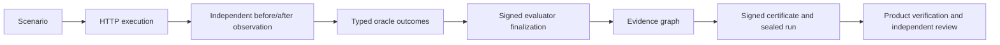

The release gate runs `tests/acceptance/test_release_evidence_chain_matrix.py`.
Every case starts with real HTTP execution against an agent and a separate state
authority. The agent commits a debit through the authority's write API. Runtime
reads the authority before and after execution and evaluates the declared state
oracle. The successful case proves the entire chain:



`complete_chain` is the positive case for every boundary. Corruption cases start
with copies of those actual execution artifacts, except the false-success and
unavailable-observation cases, which change the real execution environment.

| Boundary | Positive evidence | Deliberately corrupted cases |
| --- | --- | --- |
| Scenario | Declared operation, agent endpoint, authority, and required state assertion | `altered_scenario` |
| Execution | Agent HTTP call commits the debit through the authority; recorded execution mode agrees with the signed claim | `omitted_execution`, `false_agent_success`, `contradictory_execution_mode` |
| Independent observation | Authority reads show 100 before and 75 after; durable transition rows and oracle references bind both snapshot hashes | `omitted_observation`, `altered_observation`, `unavailable_observation` |
| Oracle outcomes | Required `ledger_balance` oracle reports PASS from observed state | `omitted_oracle`, `failed_oracle`, `false_agent_success` |
| Signed finalization | Exactly one signed record binds the execution manifest, evidence root, oracle inventory, and verdict | `omitted_finalization`, `unsigned_finalization`, `duplicate_finalizations` |
| Evidence graph | Product verification rebuilds the graph from exact raw trace bytes; the independent reviewer recomputes the exported root from leaf commitments | `altered_graph`, `altered_root`, omitted observation evidence |
| Certificate | Canonical signatures bind the execution manifest, current profile, provisional restriction, and verification package | `altered_manifest`, `unsigned_package`, `invalid_certificate_signature`, `provisional_certificate`, `legacy_certificate_profile` |
| Independent verification | Externally anchored signatures, trace digest, scenario and manifest hashes, graph root, complete oracle inventory, and sealed lifecycle agree | `omitted_trace`, `unsealed_run`, every alteration above |

The independent reviewer uses `hashlib`, JSON encoding, and `cryptography` public
key verification. It does not call Runtime canonicalization, signing, or
verification helpers. Its JSON encoder is deliberately limited to the finite,
ASCII fixture domain; it is an acceptance oracle, not a general certificate SDK.
The product verifier separately reconstructs evidence from raw trace bytes.

The duplicate-finalization case first proves that a new unsealed provider cannot
issue a certificate for the duplicated stream. It then re-signs the modified
exported package and trace digest. Verification therefore requires an explicit
uniqueness rejection rather than relying on an invalid signature or stale trace
hash. Unsealed and corrupt certificate
views are read-only test adapters; the real sealed provider is never rewritten.

False agent-success claims leave the authority's balance at 100. Despite a
successful agent response, the required oracle fails and no certified passing
verdict is permitted. An unavailable authority prevents issuance altogether.

Run the mandatory matrix with:

```bash
python -m pytest tests/acceptance/test_release_evidence_chain_matrix.py -o junit_family=xunit1 --junitxml=reports/acceptance/evidence-chain-matrix.xml
python tools/ci/verify_evidence_chain_matrix.py reports/acceptance/evidence-chain-matrix.xml --output reports/acceptance/evidence-chain-matrix-summary.json
```

Both release workflows require these commands to succeed. The report checker
requires all 22 named cases, rejects duplicate or skipped cases, checks the
expected certification decisions, and requires independent positive verification
and pre-seal duplicate rejection proof. The artifact
`reports/acceptance/evidence-chain-matrix.xml` records the boundary, expected
certification result, product failures, independent review result, and run
verdict for each case. A skipped, failed, or missing observation is never a
positive proof of certification.

Each corruption also checks the verdict of every consumer responsible for that
boundary. The report records package verification, run verification, and
independent review separately, and the checker rejects contradictory results.
An altered exported graph is rejected by the independent export reviewer;
Runtime rebuilds its own graph from the unchanged raw trace. Certificate
signature and sealed-state corruptions are rejected by run verification and
independent review. A false agent-success claim produces a valid negative
attestation (`ATTESTED_FAIL`) with independent integrity verification and no
certified passing verdict. An unavailable observation must prove issuance
rejection.

Issuer provisional restrictions are carried in both the certificate and signed
package metadata. Detaching a package cannot turn a provisional certificate
into a certified pass, and clearing the restriction invalidates the package
signature. The package verification endpoint enforces the same restriction.
Authoritative packages carry the current `metadata.certificate_profile` and
a signed Boolean `metadata.provisional`. Older profiles remain available to
explicit diagnostic verification. Low-level artifact-binding checks also
return diagnostic verdicts.

Verification reconciles the signed execution-mode claim against the actual
manifest configuration and raw run-start declarations, including provisional
restrictions. A missing run-start mode prevents authoritative success.
The three profile, provisional, and contradictory-mode matrix cases retain
valid cryptographic signatures. Their report proofs must identify the semantic
rejection and demonstrate valid cryptographic integrity; a signature or trace
hash failure cannot substitute for this proof.

The separate mutation sentinel first runs each unchanged target through the same
injection loader used for mutations on every invocation; cached timings cannot
replace these controls. Collection and pytest infrastructure errors
are not mutation kills. Timeouts receive a serial retry and block the gate if
unresolved. The mutation scorecard lists reviewed equivalent exclusions with
their reasons; preflight rejects unexplained exclusions and stale source
coordinates. These controls prevent loader failures or obsolete scope entries
from appearing as test assurance.
The injection hook runs before package initialization so dependent modules and
package re-exports execute the same mutated code as direct imports.
Changes to target modules, configured tests, or validation configuration invalidate
the run. The runner preserves workspace edits and never restores saved source
files during cleanup.
