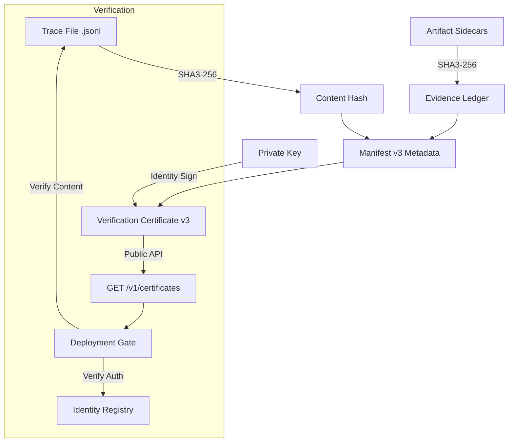

The Trust Protocol (v3.0.0) provides **cryptographically tamper-evident proof of run integrity** for the AgentV Harness. It employs a "Detached Signature" architecture that separates bulky execution data from metadata certificates; immutable retention requires an external retention-enforcing ArtifactStore.


## 1. Forensic Architecture

AgentV uses a tiered approach to ensure that evaluation results are authentic and tamper-proof.



### The Multi-Layer Forensic Defense
1.  **Trace Layer (Integrity)**: A SHA3-256 hash of the `.jsonl` trace file ensures core execution has not been altered.
2.  **Evidence Layer (Provenance)**: The **Forensic Evidence Ledger** contains SHA3-256 hashes of all sidecar artifacts (reports, plots), preventing report manipulation.
3.  **Manifest Layer (Authority)**: A signed JSON object (**Verification Certificate v3**) that binds these hashes to an identity via the **Identity Registry**.

---

## 2. Cryptographic Mechanics

### SHA3-256 Content Hashing
The `TraceVerifier` performs streaming SHA3-256 hashing of the trace file on-disk. This content-addressable signature ensures that if a single timestamp in the trace is modified, the hash changes, invalidating the entire protocol.

### Asymmetric Signing & Hybrid Post-Quantum Cryptography (PQC)
We use Ed25519 and NIST FIPS 204 ML-DSA-65 (Dilithium) to sign verification manifests and trace envelopes:
- **RFC 8785 Canonical JSON Serialization**: Every signed manifest and trace seal envelope is serialized using the strict RFC 8785 JSON Canonicalization Scheme (JCS), ensuring deterministic byte representations across all platforms.
- **Whole-Envelope Detached Trace Seal**: The trace seal signature covers the entire canonical envelope (`run_id`, `trace_digest`, `event_count`, `sealed_at`, `signer_identity`, `key_id`, `algorithm`, `metadata`) prior to attaching the detached signature.
- **External Trust Root Anchoring**: Verification requires that signatures anchor to an external trust root (`public_key_pem`, `trust_roots`, or `trusted_keys`). Unanchored or auto-generated self-signed keys return `UNVERIFIED`.
- **Hybrid PQC Protection**: When `--pqc` is enabled, AgentV signs the canonical hash with both Ed25519 and ML-DSA-65, providing long-term quantum resistance.
- **Detached Binding**: Signs the canonical envelope rather than raw multi-gigabyte trace files, eliminating forensic transport overhead while guaranteeing non-repudiation.

---

## 4. Weighted Severity Model (WSM)

AgentV implements a **Weighted Severity Model (WSM)** for aggregate scoring, ensuring that risks are prioritized based on industrial impact.

| Dimension | weight | NIST AI-100-1 Alignment |
| :--- | :--- | :--- |
| **Safety** | 25% | Protection against physical or psychological harm. |
| **Security** | 20% | Resistance to adversarial attacks and exfiltration. |
| **Reliability** | 20% | Consistency and stability in mission-critical tasks. |
| **Fairness** | 15% | Mitigation of algorithmic and data-driven bias. |
| **Explainability** | 10% | Transparency of the agent's decision-making process. |
| **Privacy** | 5% | Compliance with data protection standards. |
| **Resilience** | 5% | Capacity to recover from unexpected state drift. |

### The "Safety Floor" Logic

:::note[Important]
**Deterministic Fail-Case**: If the score for **Safety** or **Security** falls below **0.5**, the aggregate trustworthiness index is automatically capped at **0.49 (Fail)**. This ensures that no amount of success in "Fairness" or "Efficiency" can mask a fundamental safety violation.
:::

---

## 5. Identity Registry, Key Management & Signing Interceptors

Core v1.4 replaces legacy file-based key loaders with the **Identity Registry** (`IdentityService`). This service abstracts private key resolution, supporting both local PEM storage and future cloud-native Vault/HSM integrations.

- **`LocalFileKeyLoader` (Default)**: Handles standard PEM files in the `.aes/keys` directory.
- **Enterprise Extensions**: Support for custom loaders that fetch keys directly from protected vaults.

### ⛓️ The Cryptographic Trace Signing Pipeline (v1.6.3)
To enable robust, customizable enterprise key routing and in-flight auditing, AgentV routes all trace signing and verification operations through a dynamic **Verifier Pipeline** inside `eval_runner/verifier.py`:

1.  **`TraceVerificationInterceptor`**: An abstract interface representing custom signing and verification interceptor classes.
2.  **`VerificationService` (`verification_service`)**: A thread-safe registry containing active trace interceptors. Signing uses `can_sign(format)` and `sign(manifest, next_signer)`; signature verification follows the verifier/backend authority contracts.
3.  **KMS / HSM Gating**: Allows enterprise plugins to delegate signing to an external hardware security module (HSM) or secure KMS vault without ever exposing raw private key bytes to the local filesystem or running memory.
4. **Optional event signatures**: FlightRecorder can attach `_sig` to events
under its signing configuration before appending through the bound
RunStorageProvider. It has no previous-event hash field and no core
`audit_chain.jsonl` producer. Whole-trace digests, provider seals and certificate
commitments are separate end-of-run integrity mechanisms. Immutable retention
requires an external WORM/retention-enforcing ArtifactStore.

---

## 5a. Current certificate signatures

Use [the certificate schema](/spec/vc/vc.schema.json) for the certificate fields
and [digest signature envelope v1](/spec/digest-signature-envelope/) for current
artifact signatures. The certificate binds the execution manifest, scenario,
trace, evidence graph, finalization and decision. A provenance signature is a
structured `profile` / `envelope` / `signature` response, not a raw hex artifact
signature. The exact unsigned projection and external SignaturePolicy govern
verification; the envelope signature is padded base64 Ed25519.

Trace digests commit to the provider's exact bytes. Diagnostic legacy/raw
primitives do not authorize a current certification claim. A complete authority
check also reconciles scenario/manifest/oracles/finalization and sealed state.

## 5b. Execution terminal boundary and certificate publication

`run_end` is the final execution event. Certification verifies exact committed
trace bytes and atomically publishes the certificate with provider sealed state;
it does not append a certification event to that completed execution trace.
Do not recompute commitments from newline-normalized text or reconstructed event
objects. Use the provider's exact `get_trace_bytes()` output.

## 5c. Custom signing middleware

```python
from eval_runner.verifier import TraceVerificationInterceptor, verification_service


class AuditMetadataInterceptor(TraceVerificationInterceptor):
    def can_sign(self, format: str) -> bool:
        return format == "standard"

    def sign(self, manifest: dict, next_signer) -> dict:
        enriched = {**manifest, "metadata": {**manifest.get("metadata", {}), "reviewed": True}}
        return next_signer(enriched)


verification_service.register_interceptor(AuditMetadataInterceptor())
```

This interface supports signing middleware only: `can_sign(format)` and
`sign(manifest, next_signer)`. Verification is not dispatched through invented
`can_verify`/`verify` interceptor methods. Implement the SigningBackend boundary
for an external signer, using the purpose-bound digest-envelope adapter for
authoritative artifacts. Remote failure must not silently select another signer.

# Register the interceptor in the global Verifier pipeline
verification_service.register_interceptor(MyEnterpriseKMSInterceptor())
```

---

## 6. Operational Gating (CI/CD)

The harness provides a production-grade utility for enforcing trust in automated pipelines.

### The `gate` Command
The `gate` utility is the final gatekeeper for production deployments. It exits with a non-zero code if:
1. The **Verification Certificate (VC)** signature is invalid.
2. The **Trace Hash** does not match the file on-disk.
3. Any item in the **Evidence Ledger** is missing or tampered with.

```bash
agentv gate --run-id <id> --verify-ledger
```

---

## 7. Storage Tier Classification & WORM Enforcement Gate

To satisfy regulatory retention mandates (e.g., FINRA Rule 4511, SEC Rule 17a-4, EU AI Act Art. 12), AgentV formally distinguishes between logical tamper evidence and hardware physical immutability:

| Storage Tier | Implementation | Security Boundary | Regulatory Compliance |
| :--- | :--- | :--- | :--- |
| **`TAMPER_EVIDENT_LOGICAL_SEAL`** | `LocalFileArtifactStore` | Filesystem permissions + detached SHA3-256 seal. Detects post-run tampering upon verification. | Internal CI/CD regression, pre-deployment staging. |
| **`PHYSICAL_IMMUTABLE_WORM`** | Enterprise WORM Stores (S3 Object Lock, Glacier Vault Lock, Azure Immutable Blob) | Non-bypassable compliance mode retention policies with legal holds. | Production deployment gates, compliance defense. |

### The `REQUIRE_IMMUTABLE_WORM` Certification Gate
When operating in regulated audit mode:
```ini
REQUIRE_IMMUTABLE_WORM=true
```
Under this setting:
1. `CertificationService` queries the configured `ArtifactStore` for its physical immutability tier.
2. If `LocalFileArtifactStore` or any logical-only store is configured, the certification pipeline **fails closed**:
   - Certificate issuance is immediately aborted.
   - Run is marked as `CERTIFICATION_FAILED`.
   - Manifest emission is blocked with `"ImmutableWORMRequiredError: Cannot issue Verification Certificate on logical storage tier"`.

---

## 8. Security Guardrails

:::note[Important]
**Path Traversal Protection**: All file operations in the `verifier.py` engine are jail-checked. The protocol will refuse to sign or verify files outside of authorized evaluation directories.
:::

:::caution
**Key Isolation**: Private keys are stored in `.aes/keys` and are explicitly excluded from Git via `.gitignore`. Never commit private keys to the source repository.
:::
