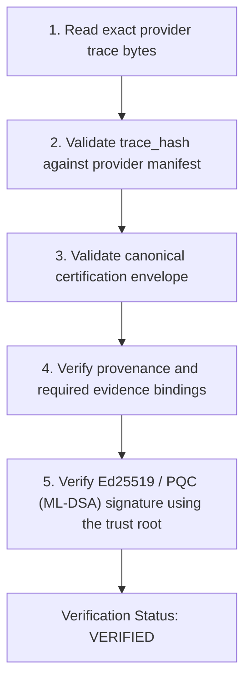
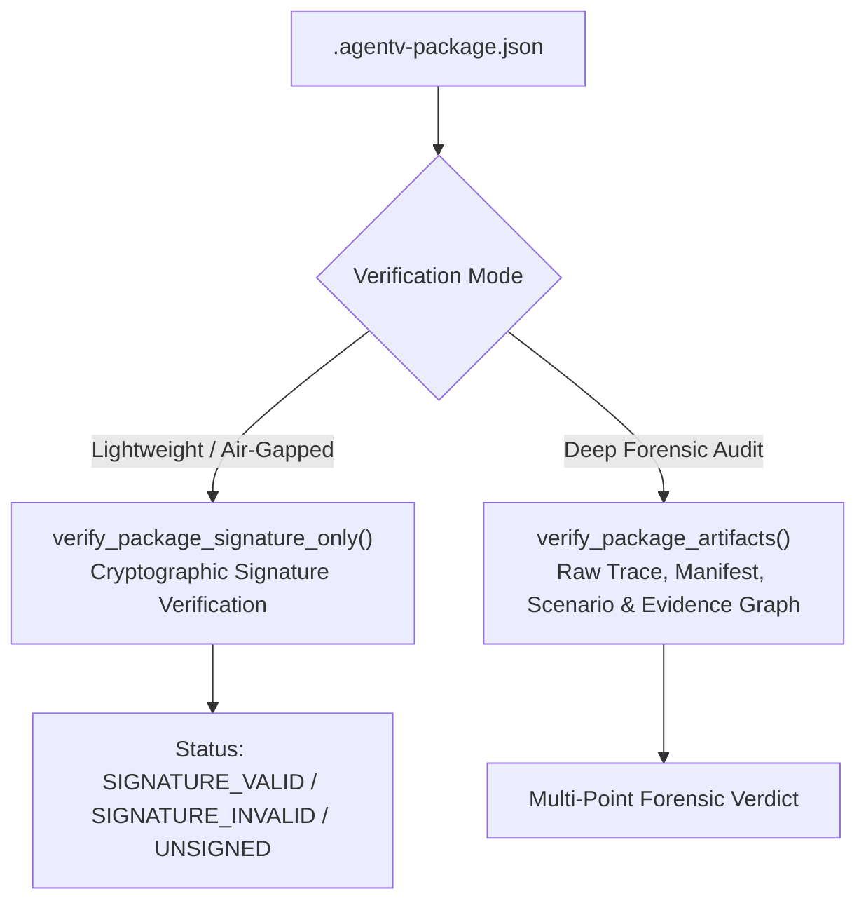

The **AgentV Verification Subsystem** provides mathematical, tamper-evident proof that evaluation runs executed authentically and achieved their required criteria.

---

## 🔬 1. Server-Authoritative Verification Endpoint

The Visual Console and external auditing systems verify runs by querying the authoritative backend verification endpoint:

```http
GET /api/v1/runs/{run_id}/verify HTTP/1.1
Host: localhost:5000
```

### Verification Evaluation Logic

The backend reads the run's manifest and the provider's exact committed trace
bytes through `RunStorageProvider`. It never discovers a run directory or
reconstructs evidence bytes from event objects. The verifier performs a
provider-native cryptographic check:



### Response Schema (Certified Run):
```json
{
  "run_id": "run_fintech_2026_01",
  "verification_status": "VERIFIED",
  "is_valid": true,
  "algorithm": "ML-DSA-65+Ed25519",
  "is_pqc": true,
  "signer_identity": "system_id",
  "trace_hash": "a8f94e2b...",
  "seal_hash": "e3b0c442...",
  "evidence_count": 4,
  "failure_reason": null
}
```

### Certification Availability

Certification is determined from the provider-owned manifest, never from a
filename, report vault, or directory layout. A manifest without a committed
certificate is not verification evidence and the endpoint returns:
```json
{
  "run_id": "run_uncertified_02",
  "verification_status": "UNVERIFIED",
  "is_valid": false,
  "has_certificate": false,
  "failure_reason": "Certification not issued"
}
```
- Auditors are guaranteed that uncertified execution artifacts are never reported as verified.


---

## 📦 2. Split Package Verification API (`VerificationAuthority`)

For decoupled, zero-trust verification pipelines, AgentV provides the **Split Package Verification API**:



### 1. Signature-Only Verification
Validates cryptographic integrity against external trust roots without requiring underlying raw trace files or artifacts on disk:
```python
from eval_runner.verifier import VerificationAuthority

# Requires an external trust root (PEM string, path, or mapping)
result = VerificationAuthority.verify_package_signature_only(
    package,
    key_registry={"system_id": public_key_pem},
)
# Returns: {"verified": True/False, "status": "SIGNATURE_VALID"|"SIGNATURE_INVALID"|"UNSIGNED", ...}
```

### 2. Deep Artifact Verification
Recomputes canonical digests from raw execution artifacts to prove zero-tampering:
```python
result = VerificationAuthority.verify_package_artifacts(
    package=pkg,
    raw_trace_bytes=raw_bytes,
    raw_trace_events=raw_events,
    canonical_manifest=manifest,
    scenario_data=scenario_dict,
    require_signature=True,
    key_registry={"system_id": public_key_pem},
)
```

### Authoritative certification verification

Use the complete authority contract to verify a certification claim. It derives all events from the exact raw JSONL bytes and requires the actual execution manifest, scenario, signed evaluator finalization, evidence root, oracle reconciliation, and package signature:

```python
result = VerificationAuthority.verify_certification_artifact(
    package=pkg,
    raw_trace_bytes=raw_bytes,
    canonical_manifest=execution_manifest,
    scenario_data=scenario_dict,
    key_registry=trusted_keys,
)
```

`verify_package(..., require_signature=True)` uses this same contract. The authoritative HTTP endpoint, `POST /api/v1/evidence/verify`, accepts `package`, base64 `raw_trace_bytes`, `execution_manifest`, and `scenario_data`; it resolves signing trust server-side. Caller-supplied keys or reconstructed event lists are rejected.

The package CLI uses authoritative verification by default:

```bash
python -m eval_runner.cli verify-package package.json --trace run.jsonl --execution-manifest execution_manifest.json --scenario scenario.json
```

Use `--diagnostic` explicitly for unsigned analysis. The CI gate rejects valid negative attestations as well as invalid evidence.

Run verification through the CLI, console, and public Trust API uses `TraceVerifier.verify_run`, which also requires the provider's sealed lifecycle state. Current certificates require a canonical manifest signature that includes the execution manifest. Legacy signature formats are available only through explicit trace-only diagnostics. Unsigned package analysis returns `DIAGNOSTIC_VALID` and cannot certify a run; HTTP callers use `/api/v1/evidence/verify-diagnostic`.

### Multi-Point Verification Checks:
1. **External Trust Root Anchoring**: The signing identity and public key are anchored against an authoritative external trust root or key registry; unanchored or self-signed keys fail closed as `UNVERIFIED`.
2. **Raw Trace Parity**: Recomputes `SHA3-256(raw_trace_bytes)` and matches against `pkg.trace_hash`.
3. **Canonical Manifest Recomputation (RFC 8785)**: Re-derives canonical manifest hash via `canonical_manifest.compute_manifest_hash()` against `pkg.manifest_hash`.
4. **Scenario Canonical Hash Binding**: Computes `compute_scenario_hash(scenario_data)` and asserts equality with `pkg.scenario_hash`. Tampered scenario definitions fail immediately.
5. **Direct Trace Provenance Enforcement**: Reconstructs the Evidence Graph from raw trace events (`build_evidence_graph_from_events`) and enforces `is_complete_provenance = True`. Any assertion evaluated without direct event linkage (e.g. carrier fallback) fails closed with `DirectProvenanceViolation`.
6. **Authoritative Verdict Precedence**: Derives final certification from authoritative terminal event verdicts. Caller-supplied status overrides and heuristic counters (`passed=True`, `success_rate`) cannot certify failed runs.

---

## 💻 3. CLI Offline Verification (`agentv verify` & `agentv verify-package`)

Audit execution traces and portable package bundles directly on disk without launching the web server:

```bash
# Verify a provider-owned run by ID:
agentv verify --run-id run_fintech_2026_01 --pqc

# Verify self-contained offline .agentv-package.json bundle:
agentv verify-package runs/run_fintech_2026_01.agentv-package.json \
  --public-key .aes/keys/trust_root_pub.pem \
  --require-signature \
  --scenario scenarios/loan_risk.json \
  --require-scenario
```

---

## 🚦 4. CI/CD Hard Gating (`agentv gate`)

The `agentv gate` command acts as a non-bypassable quality gate for deployment pipelines.

```bash
# GitHub Actions / GitLab CI Step
agentv gate \
  --run-id $RUN_ID \
  --verify-ledger \
  --pqc
```

### Exit Codes:
- `0`: Run is cryptographically authentic, ledger is complete, and all required assertions passed.
- `1`: Tamper detected, signature invalid, or failure criteria violated.

---

## 🌐 5. Framework Adapter Verification Matrix

Verify connectivity and readiness across target frameworks:

```bash
# AG2 (AutoGen)
agentv run --path scenarios/loan_risk.json --protocol ag2

# LangGraph
agentv run --path scenarios/loan_risk.json --protocol langgraph --agent http://localhost:8000/execute_task

# CrewAI
agentv run --path scenarios/loan_risk.json --protocol crewai --agent http://localhost:8000/execute_task

# Frontier Model Direct Adapters
agentv run --scenario scenarios/loan_risk.json --protocol gemini --agent "gemini://gemini-3.7-flash"
agentv run --scenario scenarios/loan_risk.json --protocol claude --agent "claude://claude-opus-5"
agentv run --scenario scenarios/loan_risk.json --protocol openai --agent "openai://gpt-5.6"
agentv run --scenario scenarios/loan_risk.json --protocol ollama --agent "ollama://deepseek-r1:70b"
```
