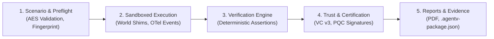

The **AgentV Evaluation Framework** provides industrial-grade verification for autonomous AI agents. Unlike simple prompt-response test harnesses, AgentV evaluates agent systems across multi-turn stateful execution trajectories, validating real-world tool interactions, virtual filesystem mutations, and safety constraints.

---

## 🧭 The Industrial Evaluation Lifecycle

Every evaluation flows through an end-to-end 5-stage pipeline:



1. **Scenario & Preflight**: Scenario definitions are validated against AES schemas, and a SHA3-256 `preflight_fingerprint` ensures readiness.
2. **Sandboxed Execution**: Agents interact with isolated **World Shims** (mock databases, REST APIs, Git repositories, email clients) while the engine captures OpenTelemetry-aligned event streams.
3. **Verification Engine**: The runtime executes deterministic assertions (registered metrics such as `state_verification` and `tool_call_correctness`, plus separate expected-outcome assertions and semantic judges).
4. **Trust & Certification**: Execution records evidence and finalization. A separate certification operation verifies eligible live evidence and atomically publishes a signed certificate with sealed provider state.
5. **Reports & Evidence**: Generation of truthful executive PDF reports and self-contained immutable Verification Packages (`.agentv-package.json`).

---

## 🏗️ Scenario Specification (AES)

Scenarios are authored in the **Agent Evaluation Specification (AES)** format (JSON or YAML), defining a Directed Acyclic Graph (DAG) of tasks:

```yaml
aes_version: 1.4
industry: finance
metadata:
  id: loan_approval_risk_check
  name: Commercial Loan Underwriting & Risk Assessment
  compliance_level: Standard
  attribution: AgentV Scenario Suite
  version: "1.0.0"
  complexity: medium
  capabilities:
    - tool_use
    - multi_turn_reasoning
    - compliance_enforcement

workflow:
  nodes:
    - id: step_1_credit_pull
      task_description: "Retrieve credit score and debt-to-income ratio for applicant ID: APP-89421."
      required_tools:
        - credit_bureau_api
      success_criteria:
        - metric: tool_call_correctness
          threshold: 1.0
      expected_outcome:
        - target: environment.credit_pull_completed
          expected: true

    - id: step_2_risk_decision
      task_description: "Calculate overall risk rating and approve or decline loan per policy FIN-POL-402."
      required_tools:
        - loan_decision_service
      success_criteria:
        - metric: policy_compliance
          threshold: 1.0
      expected_outcome:
        - target: message
          expected: "STATUS: APPROVED"
          mode: regex

  edges:
    - from: step_1_credit_pull
      to: step_2_risk_decision
      condition: "step_1_credit_pull.status == 'success'"

evaluation:
  consensus:
    strategy: Majority_Vote
    min_judges: 1
```

---

## ⚖️ Evaluation Metrics & Scoring Engine

AgentV evaluates agent trajectories across multiple rigorous metric categories:

| Metric Name | Category | Evaluation Method |
| :--- | :--- | :--- |
| `tool_call_correctness` | Tooling | Set comparison of actual and expected tool names; arguments are not checked by this metric. Use explicit assertions for argument validation. |
| `state_verification` | State | Deep-equality check of virtual environment state using dot-notation JSON paths. |
| `calculation_accuracy` | Numerical metric | Compares expected and observed numeric content. |
| Structured assertions | Separate contract | Use supported assertion contracts; `json_schema` is not a built-in metric name. |
| `expected_outcome.mode=regex` | Assertion mode | Pattern matching under the separate expected-outcome contract. |
| `policy_compliance` | Governance | Returns failure when history recursively contains `status: "policy_violation"`. PolicyEvaluator enforcement and policy configuration are separate. |
| `delegation_loop_risk` | Efficiency | Loop-detector identifying infinite reasoning cycles or ping-pong replanning. |
| `luna_judge_score` | Semantic | Asynchronous LLM judge scoring based on custom rubrics (`clinical_safety`, `fiduciary_accuracy`). |

---

## 📊 Pass@K Statistical Evaluation

For non-deterministic agents, evaluating on a single trial can produce misleading variance. AgentV supports **Pass@K** multi-attempt evaluation:

$$\text{Pass@K} = \mathbb{E}\left[ 1 - \frac{\binom{n - c}{k}}{\binom{n}{k}} \right]$$

Where:
- $n$ is total generated attempts per scenario (`--attempts n`).
- $c$ is the number of passing attempts.
- $k$ is the evaluation sample threshold (e.g. Pass@1, Pass@3).

```bash
agentv evaluate --path scenarios/finance/ --attempts 5 --limit 20
```

---

## 🌐 Community Benchmarks & URI Protocol

AgentV converts explicitly selected benchmark datasets into scenarios through URI schemes:

- **GAIA Benchmark**: `gaia://datasets/gaia.jsonl`
- **AssistantBench**: `assistantbench://datasets/assistantbench.json`

Provide an existing JSON, JSONL, or Parquet dataset containing questions and reference answers.
GAIA accepts `Question` / `Final answer`; AssistantBench accepts `task` / `answer`.
Each row becomes an AES scenario with its original answer and a SHA3-256 row digest.
Missing files, empty datasets, duplicate identities, and malformed records raise errors.

For HuggingFace, install the optional `datasets` package and select the source explicitly:
`gaia://hf://gaia-benchmark/GAIA?config=2023_all&split=validation&revision=<commit>`.
Remote loading is disabled in airgap mode. Local Parquet input requires pandas and a Parquet engine.

```bash
agentv run --scenario gaia://datasets/gaia.jsonl --agent http://localhost:5001/execute_task
```

---

## 🛠️ Reproducibility & Deterministic Seeds

To guarantee scientific reproducibility across runs:
- Provide `--seed <integer>` on the CLI to initialize all random generators, world shim states, and mock data generators deterministically.
- All scenario files and configurations are stamped with deterministic SHA3-256 hashes recorded in the final run manifest.
