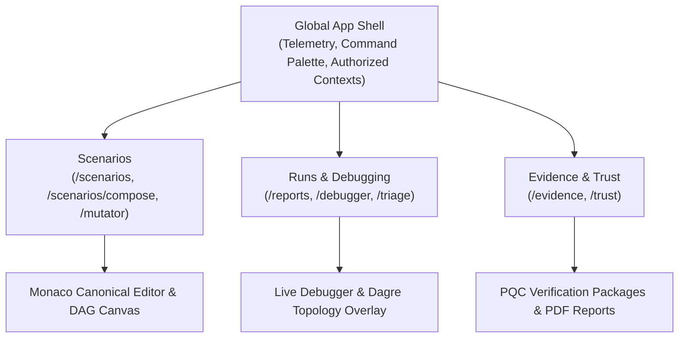
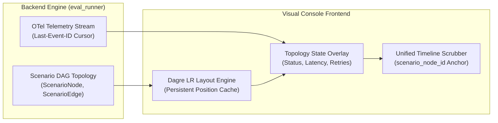
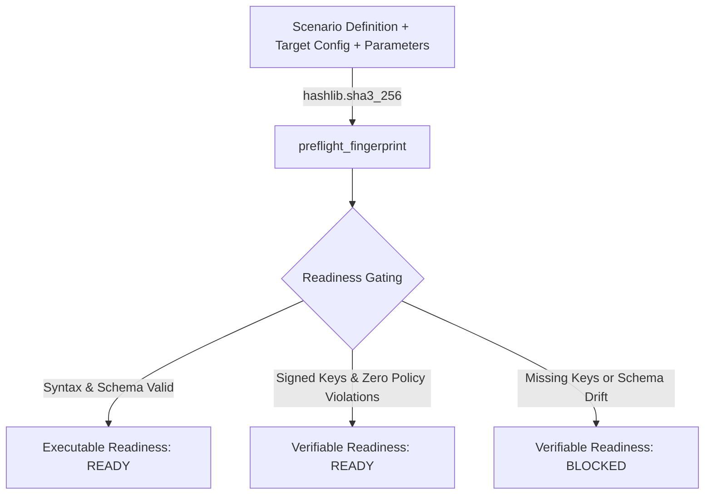

The **Visual Console** (launched via `agentv console`) is the enterprise single-page application (SPA) for managing the complete agent assurance lifecycle:
**Compose → Validate → Run → Verify → Investigate → Issue Evidence**.

```bash
agentv console --host 127.0.0.1 --port 5000
```

---

## 🧭 Information Architecture

The interface organizes all evaluation workflows into distinct operational views:



---

## 1. 🔬 Live Debugger & Canonical Execution Graph

The **Live Debugger** (`/debugger`) provides real-time, deterministic inspection of agent reasoning, state transitions, tool invocations, and virtual filesystem mutations.



### Key Architectural Pillars:

1. **Scenario-Primary Execution Topology**:
   - The structural graph topology is derived directly from the canonical Scenario DAG (`scenario_node_id`, `from_scenario_node_id`, `to_scenario_node_id`).
   - OpenTelemetry runtime events dynamically overlay real-time status badges (`success`, `failed`, `running`, `retrying`), latency measurements, and attempt counts without perturbing the underlying graph structure.

2. **Canonical Identity Triple**:
   - `scenario_node_id`: Stable scenario node identifier acting as the primary join key across backend engine, frontend graph, and timeline.
   - `execution_instance_id`: Per-attempt unique instance key formatted as `{scenario_node_id}:attempt:{n}`.
   - `parent_execution_id`: Explicit lineage identifier tracking retry and branching relationships.

3. **Layout Stability & Persistent Coordinate Cache**:
   - Automatic graph layout is computed using a directed acyclic graph (Dagre `LR` left-to-right) engine.
   - User drag-and-drop manual position adjustments are cached persistently in `nodePositionsRef`, preventing jarring layout jumps or node snaps during high-frequency live SSE event streaming.

4. **Resilient SSE Streaming with `Last-Event-ID` Catch-Up Replay**:
   - Telemetry streams over HTTP Server-Sent Events (`GET /api/v1/runs/<run_id>/stream`).
   - Every event payload includes a monotonically increasing `id`. If a network interruption occurs, the client automatically reconnects with the `Last-Event-ID` header, causing the backend to replay buffered historical events seamlessly without duplicate state emissions or missing frames.

5. **Bidirectional Timeline Synchronization**:
   - The bottom timeline scrubber displays chronological event slices. Clicking any step in the timeline automatically centers and highlights the corresponding node in the visual graph via its `scenario_node_id`.

6. **Edge Visual Hierarchy & Disambiguation**:
   - In `executed` and `divergence` modes, planned/unexecuted edges are visually subordinated with muted dashed lines (`stroke-dasharray: 4,4`), preventing visual clutter.
   - Executed edges are accentuated as solid paths dynamically color-coded by the downstream node's execution outcome (`#10b981` success, `#f43f5e` failure/deviation).
   - An interactive **Edge Hierarchy Legend** in the debugger toolbar provides immediate visual clarity across planned, executed, and divergent pathways.

7. **Canonical Terminal Status Sets (`CANONICAL_TERMINAL_STATUSES`)**:
   - Unifies terminal state resolution across the debugger. Explicitly treats `STALLED` as a distinct non-success terminal condition alongside `COMPLETED`, `FAILED`, `CANCELLED`, and `TIMEOUT`.
   - Prevents looping, infinite replanning, or hanging runs from remaining indefinitely in indeterminate "running" animations.

8. **Planned Scenario Spine Projection**:
   - When operating in `executed` layer mode before execution events arrive, the canvas renders the planned scenario DAG spine with dashed borders and `Planned (Pending Execution)` status labels, preventing confusing blank canvas states.

9. **URL Parameter Authority & Stream Control Resilience**:
   - The URL-selected `run_id` acts as the authoritative truth, preventing asynchronous `/api/runs` polling races from hijacking active debugging sessions.
   - Handles typed stream control signals (`timeout`, `error`, `end`, `stream_end`) without dropping frames even when transport cursor IDs are omitted.

---

## 2. 🎨 Visual Composer & Monaco Source of Truth

The **Scenario Composer** (`/scenarios/compose` or `/editor`) offers dual-mode scenario authoring, uniting visual graph-based workflow design with industrial code editing.

### Features:

- **Monaco Canonical Source of Truth**:
  - The embedded Monaco JSON/YAML editor acts as the authoritative document state.
  - Edits in the visual canvas instantly reflect in the code editor, and syntax changes in Monaco immediately re-render the visual graph via bi-directional AST synchronization.
- **Scenario Lifecycle State Machine**:
  - Governs scenario lifecycle across formal enterprise stages:
    $$\text{Draft} \longrightarrow \text{Validated} \longrightarrow \text{Ready} \longrightarrow \text{Published} \longrightarrow \text{Deprecated}$$
  - **Mandatory Audit Reason Gate**: Transitioning from `Ready` to `Published`, retiring any scenario to `Deprecated`, or demoting from `Validated` back to `Draft` requires entering an explicit audit justification reason in an interactive dialog, recorded into the audit ledger for governance compliance (`TRANSITION_REQUIRES_REASON`).
- **Typed Scenario Assertions**:
  - Author structured verification criteria directly within the editor:
    - `exact`: Deterministic literal string or value matching.
    - `regex`: Regular expression pattern validation on agent outputs.
    - `numerical_tolerance`: Threshold validation with absolute and relative delta bounds.
    - `json_schema`: Full JSON Schema validation against structured payloads.
- **Conditional Edge Editing**:
  - Configure branching conditions and decision predicates connecting workflow steps.
- **Optimistic Concurrency Control**:
  - Scenario saves enforce document revision hashing (`expected_revision_hash`), preventing accidental overwrites in multi-user environments.
- **Dark Mode Canvas & Node Dragging**:
  - Smooth pan/zoom canvas, customized node connectors, and validation error markers.

---

### 🌪️ Adversarial Mutator & Linter Assessment (`/mutator`)

The **Adversarial Mutator** provides an interactive visual studio for generating and inspecting adversarial stress-tests from the installed mutation catalog:

- **Dynamic Mutation Catalog Discovery**:
  - Queries the backend at `GET /api/v1/mutations` to populate executable mutator descriptors with provider-declared vector and delivery capabilities. The formal vocabulary has 14 vectors; `time` is the coordinate name, and vocabulary membership does not guarantee execution support.
  - If the endpoint is unreachable, displays an explicit fail-closed error banner rather than a silent hardcoded fallback.
- **In-Memory Scenario Linter Integration**:
  - Chains `ScenarioLinter.lint_dict` and renders a real-time **Lint Tier & Health Assessment** banner above the Monaco Diff Viewer.
  - Displays the scenario tier, score (0–100), and schema errors or warnings. Tiers are `GOLD` at ≥90, `SILVER` at ≥70, `BRONZE` at ≥50, and `UNRANKED` below 50; registry input returns `REGISTRY`. A tier alone does not reject execution.
- **Deterministic Mutant Lineage**:
  - Computes canonical derived IDs (`${base_id}_mutated_${mutation_type}`) bound into `metadata.name` and parent scenario references.
  - Automatically navigates to `/scenarios?q=${targetId}` upon saving to verify catalog placement.

---

## 3. ⚡ Evaluation Runner & Preflight Assurance

The **Evaluation Runner** (`/`; `/runner` redirects here) manages test execution against frontier models and custom agent endpoints.

### Preflight Fingerprinting & Dual-Tier Readiness:



1. **Deterministic Fingerprinting**:
   - A cryptographic digest (`preflight_fingerprint`) is computed using `hashlib.sha3_256` over the canonical scenario definition, target URL, and execution parameter matrix.
   - Any modification to input fields automatically invalidates stale preflight checks, triggering immediate background re-validation.

2. **Dual-Tier Readiness Gates**:
   - **Executable Gate**: Confirms that the target endpoint is reachable, required world shims are available, and the scenario workflow is structurally complete.
   - **Verifiable Gate**: Confirms that cryptographic signing keys are active (`IdentityService`), policy references are satisfied, and zero security warnings exist.

3. **Frontier Model Targets (2026 Baselines)**:
   - Built-in connection profiles for **Gemini 3.7 Flash**, **Claude Opus 5 / Claude 3.7 Sonnet**, **OpenAI GPT-5.6**, and local **Ollama** fleets (`deepseek-r1:70b`, `llama-3.3`).

---

## 4. 🗂️ Scenario Library & Catalog Navigation

The **Scenario Library** (`/scenarios`) enables exploration across thousands of pre-built industrial benchmarks:

- **Taxonomy & Sector Filtering**: Filter by industry domain (Finance, Healthcare, Defense, Smart Cities, etc.), NIST AI 100-1 trustworthiness dimensions, and difficulty level (L1 Basic to L5 Complex Interactive).
- **Readiness Probes**: Instant visibility into whether scenarios are fully runnable or require specific environment secrets.
- **Full-Text Search**: Instant search matching across title, tags, intent descriptions, and tool requirements.

---

## 5. 📑 Runs, Evidence & PDF Reports

### Runs, Run Detail & Evidence Inspector (`/reports`, `/runs/<run_id>`):
- **Filtering & Navigation**: Filter by status (`passed`, `failed`, `running`, `unverified`, `error`).
- **Temporal Start Time Identifier**: Prominently displays the ISO timestamp and local formatted time as a distinct temporal run identifier in the header banner with a `Clock` icon and quick metrics card.
- **Derived Execution Duration & Score**: Computes duration from explicit run timestamps or streaming event boundaries, and derives assurance score from the certificate manifest, evidence package, or passed/total ratio of evaluated assertions.
- **Authoritative Assertions Hydration**: Aggregates canonical `execution_graph_node.oracle_results` across all trace events, mapping observed values to actual outputs with zero synthetic stubs.
- **Truthful Uncertified Run Resolution**: When viewing uncertified runs, the UI truthfully reports `UNVERIFIED` status and `Certification not issued`, preventing misleading assertions of compliance.
- **Truthful Enterprise PDF Generation**:
  - The PDF generation engine (`eval_runner/console/pdf_service.py` via ReportLab) derives execution metrics, timestamps, and pass/fail states from provider-owned run records, manifests, and events.
  - Zero manufactured or hardcoded placeholder strings; unverified runs explicitly reflect `UNVERIFIED` badges.

The core router does not provide `/leaderboard` or `/runs/new`. Use the CLI
leaderboard command for provider-backed ranking output, or an explicitly
installed extension for additional UI pages. `/scenarios/compose` remains the
scenario composer route.

---

## 6. 🛡️ Trust Center & Evidence Verification

The **Trust Center** (`/trust`) provides cryptographic transparency for non-repudiable audit logs:

- **Server-Authoritative Verification**:
  - The UI verifies runs by querying `/api/v1/runs/<run_id>/verify`, which verifies the provider's exact trace bytes against its provider-owned manifest.
  - Mathematical proof verification of the trace hash (`sha3_256`), certification envelope, seal state, and Ed25519 / Post-Quantum (PQC) signatures.
- **Downloadable Verification Packages (`.agentv-package.json`)**:
  - Download self-contained, tamper-proof packages conforming to NIST SP 800-218 and EU AI Act specifications.

---

## 7. Extension integrity and authentication

The host discovers declared navigation through `/api/nav`, verifies remote entry
and chunk SRI, validates signed sidecar bindings and resolves publisher trust on
the server. Verified modules render as React components in the host; they are
not isolated iframes. Production mounts only backend-verified official publishers
and rejects unsigned/community execution. See the
[extension workflow](/extender/gui-extensions/) for publishing and activation.

The authenticated runtime context API supplies context switching and authorized
fetches. Context choices are constrained by provider-owned entitlements; changing
a displayed role does not grant permissions. Protected scenario/run reads require
authentication. In local first-run onboarding, use the bootstrap key instructions
printed by the Console; in production configure stable credentials and trust.
