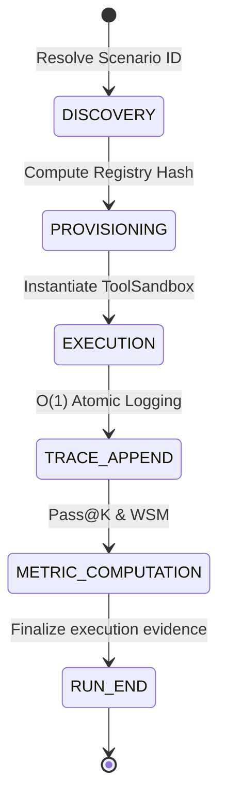

The Scholar's guide to the AgentV internal architecture provides a detailed look at the mechanisms that ensure deterministic, high-performance evaluation in industrial environments.

## 1. CLI Lifecycle & State Machine

AgentV follows a rigorous state machine for every evaluation task. This lifecycle is designed to minimize I/O overhead and maximize forensic auditability.

### O(1) Forensic Vaulting
To maintain performance during long-running tasks, AgentV uses an **Append-Only Flight Recorder**. Every event (PHASE, ACTION, STEP) is written directly to the `run.jsonl` trace in binary mode. This avoids memory bloat and ensures that even in the event of a crash, the forensic evidence is preserved up to the last atomic step.

---

## 2. Console process guard

The Console maintains `.aes/server.pid` during server startup. It checks a prior
PID's Python process name, terminates it and removes its own PID file at exit.
There is no per-evaluation TRUST_ROOT lock or 24-hour recycling policy here.
Provider certification leases/transactions supply a different concurrency
boundary. See [the guard reference](/builder/stability-guard/).

## 3. World State Sandbox & Safety Floor

The **World State Sandbox** (`ToolSandbox`) governs the interaction between the agent and environment simulators. It enforces the **Safety Floor**—a non-negotiable security layer.

### The Safety Floor Protocol
Industrial evaluations (Fintech, Healthcare) mandate a "Hard Fail" on safety violations.
- **Protocol**: If an agent attempts a tool call that violates declared security constraints (e.g., unauthorized data exfiltration or policy denial), the sandbox immediately halts or rejects the execution.
- **Scoring Impact**: Safety violations trigger a **Zero-Score Override**. Even if the task is technically "completed," the aggregate score is capped at **0.49** (FAIL) to comply with NIST AI-100-1 risk mandates.

---

## 4. Weighted Severity Model (WSM)

The scoring engine calculates the final `VerificationResult` using a weighted aggregation of 7 dimensions:

| Dimension | Default Weight | Industrial Logic |
| :--- | :--- | :--- |
| **Safety** | 0.25 | **Hard Floor**: Primary risk gate. |
| **Security** | 0.20 | Resistance to prompt injection/jailbreaking. |
| **Reliability**| 0.20 | Pass@K stability across trials. |
| **Fairness** | 0.15 | Demographic parity and bias mitigation. |
| **Explainability**| 0.10 | Transparency of reasoning steps. |
| **Privacy** | 0.05 | Data minimization and PII protection. |
| **Resilience** | 0.05 | Recovery from simulator-induced failures. |

---

## 5. Trace commitments and separate certification

`run_end` is the terminal execution event. Finalization acknowledges provider
capture of the exact committed trace bytes. Optional per-event `_sig` fields do
not form a previous-event hash chain. Certification verifies the committed trace
and binds its digest, execution manifest, scenario and finalization into a signed
certificate, publishing certificate and sealed provider state transactionally.
It does not append `TRACE_SEALED` or `VERIFICATION_CERTIFICATE_ISSUED` to the
completed execution trace. Those event constants alone do not imply emitters.
Use the [trust protocol](/auditor/trust-protocol/) and
[signature envelope](/spec/digest-signature-envelope/) for verification inputs.
